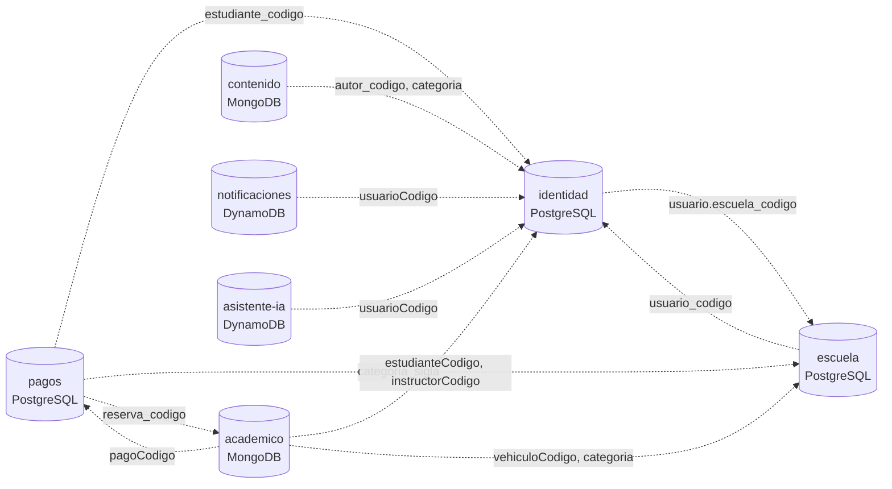
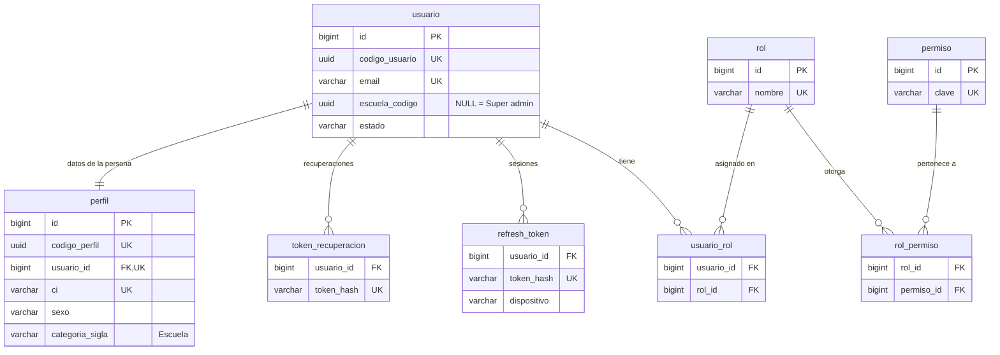
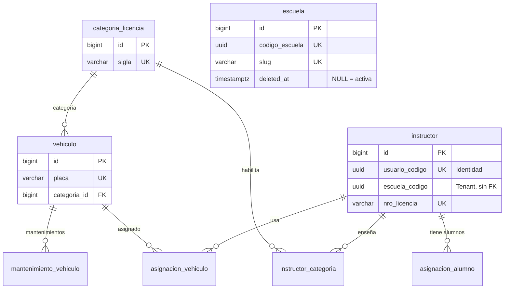
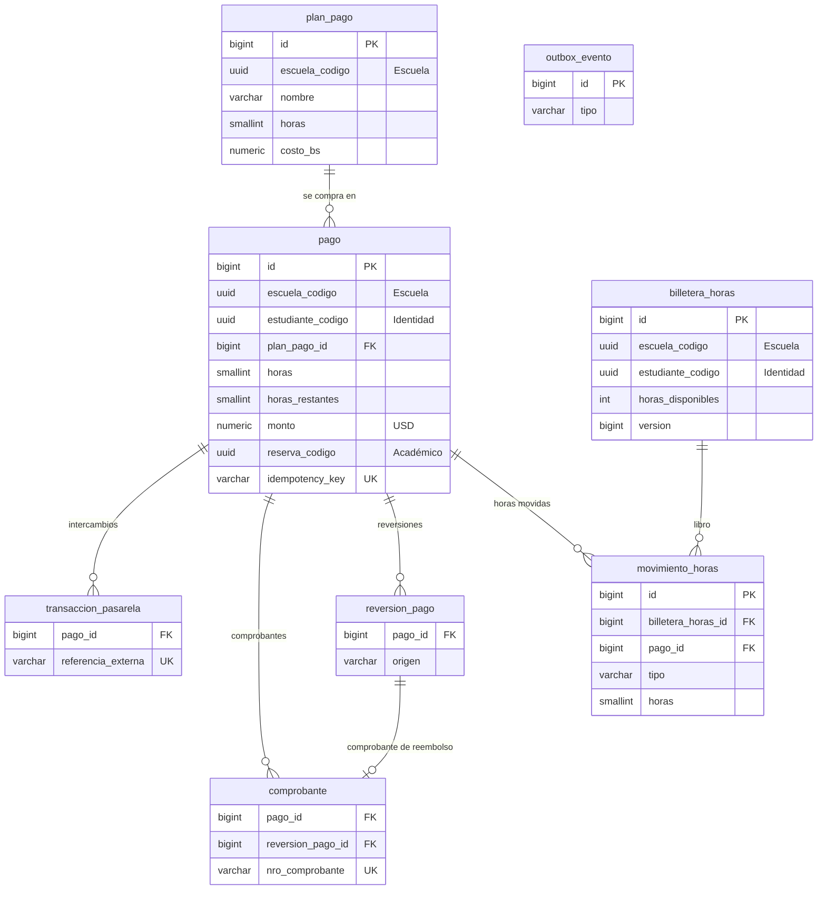
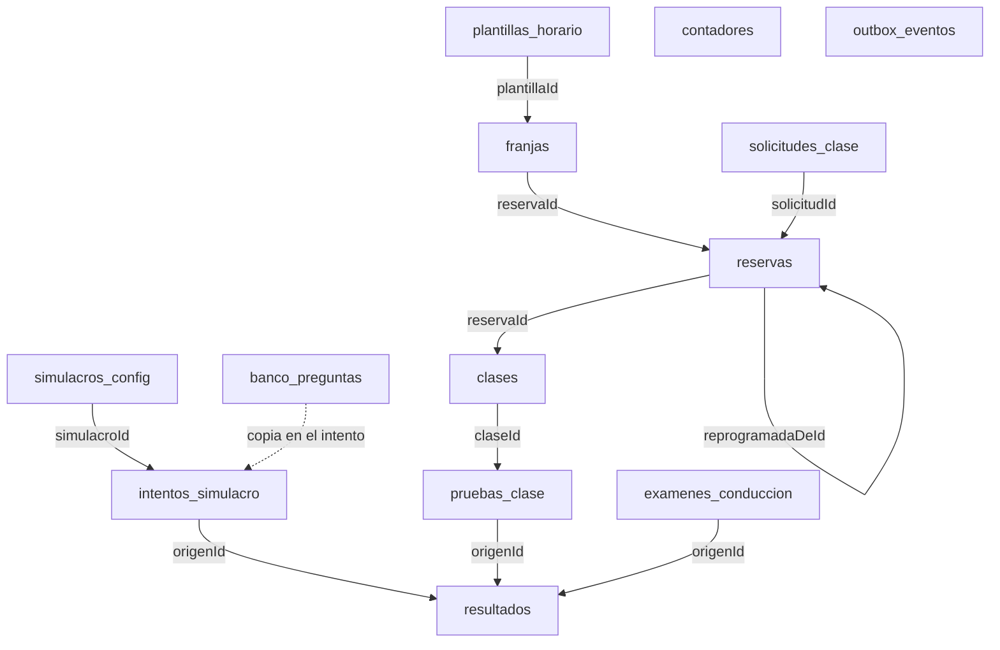

# Diseño de base de datos — estado real

> **Fuente de verdad.** Este documento describe las tablas, colecciones e
> ítems **tal como existen hoy en el código** (migraciones Flyway, documentos
> de Spring Data MongoDB, migraciones de Laravel y definiciones de DynamoDB).
> El PDF [`DriveHub_Diseno_Base_de_Datos.pdf`](DriveHub_Diseno_Base_de_Datos.pdf)
> queda como **guía histórica**: si algo difiere, gana este archivo.
>
> **Se actualiza en el mismo cambio que toca el esquema** (una migración
> nueva, un campo nuevo en un documento, un GSI nuevo), igual que
> [`docs/errors/`](../errors/README.md) con los códigos de error.
>
> Reglas de implementación (ids, nombres, migraciones, soft delete):
> [PERSISTENCIA_BD_BACKEND.md](../../.claude/rules/backend/PERSISTENCIA_BD_BACKEND.md).

Última revisión: 2026-10-21 (se agregó CU12 en Académico).

## Contenido

1. [Visión general](#1-visión-general)
2. [Identidad — PostgreSQL](#2-identidad--postgresql)
3. [Escuela — PostgreSQL](#3-escuela--postgresql)
4. [Pagos — PostgreSQL](#4-pagos--postgresql)
5. [Académico — MongoDB](#5-académico--mongodb)
6. [Contenido — MongoDB](#6-contenido--mongodb)
7. [Notificaciones — DynamoDB](#7-notificaciones--dynamodb)
8. [Asistente IA — DynamoDB](#8-asistente-ia--dynamodb)
9. [Referencias entre servicios](#9-referencias-entre-servicios)
10. [Diferencias con el PDF y pendientes](#10-diferencias-con-el-pdf-y-pendientes)

---

## 1. Visión general

| Servicio | Base | Nombre | Tablas / colecciones | Cómo se crea el esquema |
| --- | --- | --- | --- | --- |
| `identidad` | PostgreSQL 18 | `identidad` | 7 | Flyway (`V…__*.sql`) |
| `escuela` | PostgreSQL 18 | `escuela` | 9 | Flyway |
| `pagos` | PostgreSQL 18 | `pagos` | 8 | Flyway |
| `academico` | MongoDB 8 (replica set `rs0`) | `academico` | 13 | Spring Data (`@Document`, `@Indexed`) |
| `contenido` | MongoDB 8 (replica set `rs0`) | `contenido` | 2 + `contadores` | Migración de Laravel |
| `notificaciones` | DynamoDB | — | 4 | `definicion-tablas.ts` (se crean al arrancar en dev) |
| `asistente-ia` | DynamoDB | — | 4 | `tablas.py` (se crean al arrancar en dev) |

`gateway` no tiene base de datos. **Una base por servicio**: ninguno lee la base de otro.

### Convenciones comunes

- **PostgreSQL:** cada tabla lleva además `id BIGINT GENERATED ALWAYS AS IDENTITY PRIMARY KEY` (interno, no sale del servicio), `codigo_{tabla} UUID NOT NULL UNIQUE` (público, UUID v7 generado por la aplicación) y `created_at`, `updated_at`, `deleted_at` (`TIMESTAMPTZ`, soft delete). **No se repiten en las tablas de abajo**: solo se listan las columnas propias.
- **MongoDB:** cada documento lleva `_id` (Long secuencial, interno, de la colección `contadores`), `codigo{Coleccion}` / `codigo_{coleccion}` (UUID v7 público, índice único), `createdAt`/`updatedAt`/`deletedAt` (o `created_at`/… en Laravel). Tampoco se repiten. Los subdocumentos y arrays se guardan nativos.
- **DynamoDB:** no hay id Long; la clave primaria es el identificador. Los atributos van en `camelCase`.
- **Referencias a otro servicio:** `{entidad}_codigo` / `{entidad}Codigo` con el código público del dueño, **sin FK física** (ver [sección 9](#9-referencias-entre-servicios)).
- **Estados:** `VARCHAR` + `CHECK` en PostgreSQL; en Mongo/Dynamo, el valor del enum de código.

### Mapa de dependencias entre servicios

Las líneas punteadas son **referencias por código, sin FK**: se validan al escribir (REST al dueño) o se mantienen por eventos.

---

## 2. Identidad — PostgreSQL

Cuentas, roles, permisos y sesiones. Migraciones: `V20261018120000__crear_esquema_identidad.sql`, `V20261019110000__usuario_escuela_y_roles.sql` (CU01), `V20261019120000__usuario_bloqueado_hasta.sql` (CU02), `V20261020120000__correo_verificado_y_tipo_token.sql` (CU04b), `V20261021120000__cambio_de_correo.sql` (CU06), `V20261023100000__crear_perfil.sql` (CU08a), `V20261023120000__extension_unaccent.sql` (CU08).

### `usuario`

Cuenta de acceso. `codigo_usuario` es la **persona única** en toda la plataforma. CU01, CU02, CU06. Los datos de la persona (nombres, contacto, CI, sexo, ubicación) están en [`perfil`](#perfil) desde CU08a.

| Columna | Tipo | Notas |
| --- | --- | --- |
| `email` | `VARCHAR(120) NOT NULL UNIQUE` | Login. Único en **toda** la plataforma, guardado en minúsculas |
| `password_hash` | `VARCHAR(255) NOT NULL` | BCrypt, nunca en claro |
| `escuela_codigo` | `UUID` | Escuela (tenant) de la cuenta, **sin FK** → `escuela.codigo_escuela`. `NULL` para el Super admin. Índice `idx_usuario_escuela_codigo`. *CU01* |
| `estado` | `VARCHAR(12) NOT NULL DEFAULT 'ACTIVO'` | `CHECK IN ('ACTIVO','INACTIVO','BLOQUEADO')` |
| `intentos_fallidos` | `INT NOT NULL DEFAULT 0` | Se reinicia en un login correcto. Bloqueo al 5.º fallo. *CU02* |
| `bloqueado_hasta` | `TIMESTAMPTZ` | Fin del bloqueo (15 min); se levanta solo. *CU02* |
| `correo_verificado` | `BOOLEAN NOT NULL DEFAULT FALSE` | El correo se verificó con el enlace enviado. Todas las cuentas, también las existentes, empiezan en `false`. No bloquea el login: solo condiciona la recuperación de contraseña. *CU04b* |
| `ultimo_login` | `TIMESTAMPTZ` | |

### `perfil`

Datos de la persona, 1 a 1 con `usuario`, para **todos** los roles (Super admin, Administrador, Instructor y Estudiante). *CU08a*

| Columna | Tipo | Notas |
| --- | --- | --- |
| `codigo_perfil` | `UUID NOT NULL UNIQUE` | Público solo dentro del servicio: la persona se identifica por `codigo_usuario` |
| `usuario_id` | `BIGINT NOT NULL UNIQUE REFERENCES usuario(id)` | El 1 a 1 |
| `nombres` | `VARCHAR(80) NOT NULL` | |
| `apellidos` | `VARCHAR(80) NOT NULL` | |
| `telefono` | `VARCHAR(20)` | |
| `foto_url` | `TEXT` | **Clave** del objeto en el bucket privado `drivehub-identidad` (`usuarios/{codigo_usuario}/{uuid v7}.{ext}`), no una URL: la URL de lectura se firma al responder. `NULL` si no tiene foto. *CU06* |
| `fecha_nacimiento` | `DATE NOT NULL` | Para validar la edad mínima (18) al registrarse. *CU01* |
| `ci` | `VARCHAR(15) NOT NULL UNIQUE` | Documento de identidad: único en toda la plataforma, sin espacios y en mayúsculas |
| `sexo` | `VARCHAR(10) NOT NULL` | `CHECK IN ('MASCULINO','FEMENINO')` |
| `direccion` | `VARCHAR(300)` | La calcula el servidor desde `latitud` y `longitud` (geocodificación inversa); en blanco si no se pudo. `NULL` para el Super admin |
| `latitud` | `NUMERIC(9,6)` | Punto elegido en el mapa, `CHECK BETWEEN -90 AND 90`. Van juntas con `longitud` (`CHECK ((latitud IS NULL) = (longitud IS NULL))`) |
| `longitud` | `NUMERIC(9,6)` | `CHECK BETWEEN -180 AND 180` |
| `categoria_sigla` | `VARCHAR(3)` | → `escuela.categoria_licencia.sigla`, sin FK. Solo el estudiante la tiene (arranca en `SIN`) y solo la escuela la cambia |

`ci` y `sexo` son `NOT NULL` para todos; `direccion`, las coordenadas y la categoría son nulables en la base y el caso de uso las exige según el rol (el Super admin no tiene ubicación). La migración rellena las cuentas anteriores con valores provisionales (`ci = 'X' + id`, `sexo = 'MASCULINO'`, `direccion = 'X'`).

**Extensión `unaccent`** (CU08, `V20261023120000`): la búsqueda de estudiantes por nombre compara `unaccent(lower(nombres || ' ' || apellidos))`, así "jose" encuentra a "José". Solo habilita la extensión: no crea tablas ni índices.

### `rol`

Catálogo de roles. Sembrado por migración (los nombres son **datos**, no un enum cerrado).

| Columna | Tipo | Notas |
| --- | --- | --- |
| `nombre` | `VARCHAR(30) NOT NULL UNIQUE` | `SUPER_ADMIN`, `ADMIN_ESCUELA`, `INSTRUCTOR`, `ESTUDIANTE` |
| `descripcion` | `VARCHAR(120)` | |

### `permiso`

Permisos finos (previstos, sin caso de uso asignado: el CU05 original, gestionar roles y permisos, se reasignó a Gestionar escuelas). Todavía sin filas.

| Columna | Tipo | Notas |
| --- | --- | --- |
| `clave` | `VARCHAR(60) NOT NULL UNIQUE` | Ej. `reserva.crear` |
| `descripcion` | `VARCHAR(120)` | |

### `usuario_rol`

Roles de cada usuario (asociación con código propio, no `@ManyToMany`).

| Columna | Tipo | Notas |
| --- | --- | --- |
| `usuario_id` | `BIGINT NOT NULL REFERENCES usuario(id)` | |
| `rol_id` | `BIGINT NOT NULL REFERENCES rol(id)` | Índice `idx_usuario_rol_rol_id` |
| `asignado_en` | `TIMESTAMPTZ NOT NULL DEFAULT now()` | |
| | `UNIQUE (usuario_id, rol_id)` | |

### `rol_permiso`

| Columna | Tipo | Notas |
| --- | --- | --- |
| `rol_id` | `BIGINT NOT NULL REFERENCES rol(id)` | |
| `permiso_id` | `BIGINT NOT NULL REFERENCES permiso(id)` | Índice `idx_rol_permiso_permiso_id` |
| | `UNIQUE (rol_id, permiso_id)` | |

### `refresh_token`

Sesiones renovables (CU02, CU03). **Solo el hash SHA-256**: el valor en claro lo tiene el cliente. Una sesión activa por usuario y dispositivo.

| Columna | Tipo | Notas |
| --- | --- | --- |
| `usuario_id` | `BIGINT NOT NULL REFERENCES usuario(id)` | |
| `token_hash` | `VARCHAR(64) NOT NULL UNIQUE` | SHA-256 en hexadecimal |
| `dispositivo` | `VARCHAR(10) NOT NULL` | `CHECK IN ('WEB','MOVIL')` |
| `expira_en` | `TIMESTAMPTZ NOT NULL` | 7 días desde cada renovación |
| `revocado` | `BOOLEAN NOT NULL DEFAULT FALSE` | `true` al renovar (rotación), al iniciar sesión de nuevo en el dispositivo y en CU03 |

Índice `idx_refresh_token_usuario_revocado (usuario_id, revocado)`.

### `token_recuperacion`

Enlaces enviados por correo, de un solo uso: verificar el correo (CU04b), restablecer la contraseña (CU04) y confirmar el cambio de correo (CU06). Solo se guarda el hash.

| Columna | Tipo | Notas |
| --- | --- | --- |
| `usuario_id` | `BIGINT NOT NULL REFERENCES usuario(id)` | Índice `idx_token_recuperacion_usuario_id` |
| `tipo` | `VARCHAR(20) NOT NULL DEFAULT 'RECUPERACION'` | `CHECK IN ('RECUPERACION','VERIFICACION','CAMBIO_CORREO')`. Un enlace de un tipo no sirve para los otros. *CU04b, CU06* |
| `correo_nuevo` | `VARCHAR(120)` | Dirección a la que pasará la cuenta al confirmar el enlace. Solo en `CAMBIO_CORREO` (`CHECK (tipo = 'CAMBIO_CORREO') = (correo_nuevo IS NOT NULL)`). El correo de la cuenta no cambia hasta confirmar. *CU06* |
| `token_hash` | `VARCHAR(64) NOT NULL UNIQUE` | |
| `expira_en` | `TIMESTAMPTZ NOT NULL` | |
| `usado` | `BOOLEAN NOT NULL DEFAULT FALSE` | |

**Datos sembrados:** los 4 roles (migración). En el perfil `dev`, además, `superadmin@gmail.com` (`SUPER_ADMIN`, sin escuela) y `adminexample@gmail.com` (`ADMIN_ESCUELA` de `escuelaexample`) e `instructorexample@gmail.com` (`INSTRUCTOR` de `escuelaexample`, con código fijo `0198f0a0-0000-7000-8000-000000000002`), todos con contraseña `123123123`.

---

## 3. Escuela — PostgreSQL

Escuelas (tenants), instructores, flota, categorías de licencia y asignaciones. El **estudiante no tiene tabla propia** (CU08a): es una cuenta con su perfil en [Identidad](#2-identidad--postgresql) y Escuela lo referencia por su `codigo_usuario`. Migraciones: `V20261018120000__crear_esquema_escuela.sql`, `V20261019100000__crear_tabla_escuela.sql` (CU01), `V20261021100000__escuela_estado_por_borrado_logico.sql` (CU05), `V20261023100000__escuela_sin_estudiante_y_categorias.sql` (CU08a), `V20261024100000__vehiculo_escuela_codigo.sql` y `V20261024110000__vehiculo_imagen_url.sql` (CU07). CU09: `V20261024120000__instructor_con_escuela.sql`.

**Datos sembrados (perfil `dev`):** la escuela `escuelaexample`, ocho autos `SEED-001` a `SEED-008` y la ficha del instructor de ejemplo (licencia `SEED-LIC-001`, categorías `P` y `B`, vence a los 3 años), enlazada por `usuario_codigo` a la cuenta `instructorexample@gmail.com` de Identidad, que lleva un codigo fijo.

> `escuela` aún **no** se relaciona con las demás tablas de este servicio, salvo `instructor` (que ya guarda su `escuela_codigo`, CU09): el de `vehiculo`... se agrega con el diseño del filtro por tenant (antes de CU07). Ver [sección 10](#10-diferencias-con-el-pdf-y-pendientes).

### `escuela`

El **tenant** de la plataforma SaaS: cada autoescuela cliente es una fila. CU01, CU02, CU05.

| Columna | Tipo | Notas |
| --- | --- | --- |
| `codigo_escuela` | `UUID NOT NULL UNIQUE` | Es el `escuela_codigo` que guardan los demás servicios |
| `slug` | `VARCHAR(60) NOT NULL UNIQUE` | Identificador legible del enlace de registro (`/register/{slug}`) |
| `nombre` | `VARCHAR(120) NOT NULL` | |
| `deleted_at` | `TIMESTAMPTZ` | Borrado lógico y **única fuente del estado**: activa si es `NULL`, inactiva si tiene fecha. Una escuela inactiva no admite registros ni inicios de sesión de nadie de ella. Desactivar es poner la fecha y reactivar es quitarla (CU05) |

La columna `estado` (`ACTIVA`/`INACTIVA`) se **eliminó** en `V20261021100000`: era una segunda fuente que podía contradecir a `deleted_at`; la migración pasó a borrado lógico las filas que estaban `INACTIVA`. Como el filtro automático de soft delete oculta las filas eliminadas, el listado, la consulta por código y la unicidad del `slug` (que sigue reservado aunque la escuela esté eliminada) usan consultas nativas.

En `dev` se siembra `escuelaexample` con código fijo `0198f0a0-0000-7000-8000-000000000001`.

### `categoria_licencia`

Catálogo (A, B, C…). `sigla` es el valor que usan los demás servicios.

| Columna | Tipo | Notas |
| --- | --- | --- |
| `sigla` | `VARCHAR(3) NOT NULL UNIQUE` | |
| `descripcion` | `VARCHAR(100) NOT NULL` | |
| `edad_minima` | `SMALLINT` | |
| `clases_minimas` | `SMALLINT` | Mínimo de clases prácticas para rendir el examen |

Sembrada por migración (CU08a), en este orden: `P` Particular, `M` Motocicleta, `A` Profesional A, `B` Profesional B, `C` Profesional C y `SIN` Sin categoría (con la que arranca todo estudiante). `edad_minima` y `clases_minimas` quedan sin definir hasta confirmar los valores. **Las siglas y descripciones están pendientes de confirmar con el equipo.**

### `instructor`

Ficha profesional del instructor (CU09).

| Columna | Tipo | Notas |
| --- | --- | --- |
| `usuario_codigo` | `UUID NOT NULL UNIQUE` | → `identidad.usuario.codigo_usuario`, sin FK. El CI y los datos personales están en el `perfil` de Identidad |
| `escuela_codigo` | `UUID NOT NULL` | Escuela (tenant) de la ficha, sin FK (CU09). Índice `idx_instructor_escuela_codigo_estado (escuela_codigo, estado)` |
| `nro_licencia` | `VARCHAR(30) NOT NULL UNIQUE` | |
| `licencia_vence` | `DATE` | |
| `estado` | `VARCHAR(12) NOT NULL DEFAULT 'ACTIVO'` | `CHECK IN ('ACTIVO','INACTIVO','LICENCIA')` |
| `fecha_contratacion` | `DATE` | |

### `instructor_categoria`

Categorías que enseña cada instructor.

| Columna | Tipo | Notas |
| --- | --- | --- |
| `instructor_id` | `BIGINT NOT NULL REFERENCES instructor(id)` | |
| `categoria_id` | `BIGINT NOT NULL REFERENCES categoria_licencia(id)` | Índice `idx_instructor_categoria_categoria_id` |
| | `UNIQUE (instructor_id, categoria_id)` | |

### `vehiculo`

Flota (CU07). Es la primera tabla de Escuela con `escuela_codigo` (tenant): las demás lo suman con sus casos de uso.

| Columna | Tipo | Notas |
| --- | --- | --- |
| `escuela_codigo` | `UUID NOT NULL` | → `escuela.codigo_escuela`, sin FK. Es el claim `escuela` del JWT; toda consulta del repositorio filtra por él. Índice `idx_vehiculo_escuela_codigo` |
| `placa` | `VARCHAR(10) NOT NULL UNIQUE` | Única en toda la plataforma, no por escuela |
| `marca` | `VARCHAR(40) NOT NULL` | |
| `modelo` | `VARCHAR(40) NOT NULL` | |
| `anio` | `SMALLINT` | |
| `color` | `VARCHAR(20)` | |
| `transmision` | `VARCHAR(10) NOT NULL` | `CHECK IN ('MANUAL','AUTOMATICO')` |
| `categoria_id` | `BIGINT REFERENCES categoria_licencia(id)` | Índice `idx_vehiculo_categoria_id` |
| `estado` | `VARCHAR(14) NOT NULL DEFAULT 'DISPONIBLE'` | `CHECK IN ('DISPONIBLE','MANTENIMIENTO','BAJA')` |
| `kilometraje` | `INT NOT NULL DEFAULT 0` | |
| `soat_vence` | `DATE` | |
| `inspeccion_vence` | `DATE` | |
| `imagen_url` | `VARCHAR(300)` | URL https de la foto en Cloudinary (`res.cloudinary.com`); el archivo no se guarda en la base |

### `mantenimiento_vehiculo`

| Columna | Tipo | Notas |
| --- | --- | --- |
| `vehiculo_id` | `BIGINT NOT NULL REFERENCES vehiculo(id)` | Índice `idx_mantenimiento_vehiculo_vehiculo_id` |
| `fecha` | `DATE NOT NULL` | |
| `tipo` | `VARCHAR(12) NOT NULL` | `CHECK IN ('PREVENTIVO','CORRECTIVO')` |
| `descripcion` | `TEXT` | |
| `costo` | `NUMERIC(10,2)` | |
| `km_al_momento` | `INT` | |

### `asignacion_vehiculo`

Qué instructor usa cada auto (CU10). Un vehículo tiene una sola asignación vigente.

| Columna | Tipo | Notas |
| --- | --- | --- |
| `vehiculo_id` | `BIGINT NOT NULL REFERENCES vehiculo(id)` | |
| `instructor_id` | `BIGINT NOT NULL REFERENCES instructor(id)` | Índice `idx_asignacion_vehiculo_instructor_id` |
| `fecha_inicio` | `DATE NOT NULL` | |
| `fecha_fin` | `DATE` | `NULL` = vigente |
| | `UNIQUE (vehiculo_id) WHERE fecha_fin IS NULL AND deleted_at IS NULL` | `uq_asignacion_vehiculo_vigente` |

### `asignacion_alumno`

Instructor asignado a cada estudiante. Un estudiante tiene un solo instructor vigente.

| Columna | Tipo | Notas |
| --- | --- | --- |
| `instructor_id` | `BIGINT NOT NULL REFERENCES instructor(id)` | Índice `idx_asignacion_alumno_instructor_id` |
| `estudiante_codigo` | `UUID NOT NULL` | → `identidad.usuario.codigo_usuario` del estudiante, sin FK (CU08a) |
| `fecha_inicio` | `DATE NOT NULL` | |
| `fecha_fin` | `DATE` | `NULL` = vigente |
| | `UNIQUE (estudiante_codigo) WHERE fecha_fin IS NULL AND deleted_at IS NULL` | `uq_asignacion_alumno_vigente` |

---

## 4. Pagos — PostgreSQL

Planes de horas, pagos, pasarela, billetera de horas, comprobantes y reversiones. Migraciones: `V20261018120000__crear_esquema_pagos.sql`, `V20261025100000__plan_pago_de_horas.sql` (CU25) y una migración nueva de la compra de horas (CU26 a CU31, que fijan las UT: elimina `inscripcion_plan` y `cuota`, ajusta `pago`, `transaccion_pasarela`, `comprobante` y `reversion_pago`, y crea `billetera_horas` y `movimiento_horas`). El estado de la saga reserva-pago **no** vive acá ([SAGA_RESERVA_PAGO.md](SAGA_RESERVA_PAGO.md)).

**Compra de horas (CU26 a CU31).** El estudiante compra un plan de horas con tarjeta (Stripe, Checkout Session), cobrado en USD. El aviso firmado de la pasarela confirma el pago y acredita las horas en su billetera. Si algo falla después de cobrar, o el estudiante pide el reembolso de una compra que no usó, se devuelve el cobro. Es una saga corta coreografiada con `outbox_evento`, sin orquestador propio. `inscripcion_plan` y `cuota` se eliminaron: no hay cuotas.

### `plan_pago` (CU25)

Plan de horas que ofrece una escuela: un nombre, una cantidad de horas y un costo en bolivianos. Es de una escuela (multitenant): extiende `BaseEscuelaModel`. El costo en dólares **no se guarda**: lo calcula el servicio con el tipo de cambio configurado (variable de entorno `TIPO_CAMBIO_BS_USD`, sin valor por defecto en el código; hoy 11,77). Se desactiva (`activo = false`), no se borra.

| Columna | Tipo | Notas |
| --- | --- | --- |
| `escuela_codigo` | `UUID NOT NULL` | → `escuela.codigo_escuela`, sin FK. Índice `idx_plan_pago_escuela_codigo_activo (escuela_codigo, activo)` |
| `nombre` | `VARCHAR(80) NOT NULL` | Único por escuela sin distinguir mayúsculas: `uq_plan_pago_escuela_nombre (escuela_codigo, lower(nombre)) WHERE deleted_at IS NULL`, incluye los desactivados |
| `horas` | `SMALLINT NOT NULL` | `CHECK (horas BETWEEN 1 AND 500)` (`ck_plan_pago_horas`). Solo enteros |
| `costo_bs` | `NUMERIC(10,2) NOT NULL` | `CHECK (costo_bs > 0)` (`ck_plan_pago_costo_bs`). Hasta 99 999 999,99 |
| `activo` | `BOOLEAN NOT NULL DEFAULT TRUE` | |

La migración de CU25 quitó `categoria_sigla`, `nro_clases` y `nro_cuotas` y renombró `monto_total` a `costo_bs`. Un plan de horas no tiene cuotas: se paga completo en un solo cobro (CU26).

### `pago` (CU26 a CU31)

Una compra de un plan de horas. Es de una escuela (multitenant): extiende `BaseEscuelaModel`. Guarda **copia** de lo comprado (plan, horas, montos y tipo de cambio) para que un cambio posterior del plan o del tipo de cambio no lo altere. `idempotency_key` evita cobros duplicados por reintentos.

| Columna | Tipo | Notas |
| --- | --- | --- |
| `escuela_codigo` | `UUID NOT NULL` | → `escuela.codigo_escuela`, sin FK |
| `estudiante_codigo` | `UUID NOT NULL` | → Identidad. Índice `idx_pago_estudiante_created (estudiante_codigo, created_at DESC)` |
| `concepto` | `VARCHAR(10) NOT NULL` | `CHECK IN ('HORAS','CLASE','EXAMEN')`. CU26 a CU31 solo crean `HORAS`; `CLASE` y `EXAMEN` los define CU44 |
| `plan_pago_id` | `BIGINT REFERENCES plan_pago(id)` | Solo en `HORAS`. Índice `idx_pago_plan_pago_id` |
| `plan_nombre` | `VARCHAR(80)` | Copia del nombre del plan al comprar |
| `horas` | `SMALLINT` | Horas compradas (copia del plan). En `HORAS`, `CHECK (horas BETWEEN 1 AND 500)` |
| `horas_restantes` | `SMALLINT` | Horas de esta compra sin gastar. Arranca en `horas` al acreditarse; el consumo descuenta de las compras más antiguas primero. El pago es reembolsable solo si `horas_restantes = horas` |
| `reserva_codigo` | `UUID` | → `academico.reservas.codigoReserva`, sin FK. Índice `idx_pago_reserva_codigo`. Solo CU44 |
| `monto` | `NUMERIC(10,2) NOT NULL` | Lo cobrado, en USD |
| `moneda` | `CHAR(3) NOT NULL DEFAULT 'USD'` | |
| `monto_bs` | `NUMERIC(10,2)` | Costo en bolivianos del plan al comprar (referencia) |
| `tipo_cambio` | `NUMERIC(8,4)` | Bs por USD usado para fijar `monto` |
| `metodo` | `VARCHAR(15) NOT NULL` | `CHECK IN ('TARJETA')` |
| `estado` | `VARCHAR(10) NOT NULL DEFAULT 'PENDIENTE'` | `CHECK IN ('PENDIENTE','CONFIRMADO','FALLIDO','REVERTIDO')`. `REVERTIDO` = reembolsado |
| `estudiante_nombre` | `VARCHAR(160)` | Copia del nombre del estudiante al comprar (para el comprobante) |
| `escuela_nombre` | `VARCHAR(120)` | Copia del nombre de la escuela al comprar |
| `idempotency_key` | `VARCHAR(64) NOT NULL UNIQUE` | |
| `saga_codigo` | `UUID` | Saga reserva-pago (CU44) |
| `expira_en` | `TIMESTAMPTZ` | Vigencia de la página de pago; vencida, el pago pasa a `FALLIDO` |
| `confirmado_en` | `TIMESTAMPTZ` | |

Se eliminaron `cuota_id` y el concepto `CUOTA` con las cuotas. Índices: `idx_pago_escuela_codigo`, `idx_pago_plan_pago_id` y `idx_pago_estado_expira_en (estado, expira_en)` (para el proceso que vence los pendientes). Migración `V20261025190000__compra_de_horas_pago.sql`.

### `transaccion_pasarela` (CU26, CU27, CU31)

Un intercambio con la pasarela (Stripe): la sesión de cobro, su aviso de confirmación y la devolución.

| Columna | Tipo | Notas |
| --- | --- | --- |
| `pago_id` | `BIGINT NOT NULL REFERENCES pago(id)` | Índice `idx_transaccion_pasarela_pago_id` |
| `proveedor` | `VARCHAR(30) NOT NULL` | `STRIPE` |
| `referencia_externa` | `VARCHAR(80) UNIQUE` | Identificador del lado de la pasarela (sesión de cobro o devolución); localiza el pago al llegar un aviso |
| `url_pago` | `TEXT` | Dirección de la página de pago que abre la app (antes `qr_payload`) |
| `estado` | `VARCHAR(12) NOT NULL` | |
| `respuesta` | `JSONB` | Sin datos de tarjeta |

### `billetera_horas` (CU27, CU28, CU29)

Saldo de horas de un estudiante en una escuela. Es de una escuela (multitenant): extiende `BaseEscuelaModel`. Una por estudiante y escuela; se crea en la primera acreditación.

| Columna | Tipo | Notas |
| --- | --- | --- |
| `escuela_codigo` | `UUID NOT NULL` | `UNIQUE (escuela_codigo, estudiante_codigo)` |
| `estudiante_codigo` | `UUID NOT NULL` | → Identidad |
| `horas_disponibles` | `INT NOT NULL DEFAULT 0` | `CHECK (horas_disponibles >= 0)`: nunca negativo. Las horas apartadas por un reembolso en curso ya están descontadas |
| `version` | `BIGINT NOT NULL` | Bloqueo optimista: dos descuentos simultáneos no pisan el saldo |

### `movimiento_horas` (CU27, CU28, CU29, CU31)

Libro de la billetera: el saldo se puede reconstruir sumándolo. Cada fila afecta las horas de **una** compra; un consumo que cruza dos compras genera dos filas.

| Columna | Tipo | Notas |
| --- | --- | --- |
| `billetera_horas_id` | `BIGINT NOT NULL REFERENCES billetera_horas(id)` | Índice `idx_movimiento_horas_billetera_created (billetera_horas_id, created_at DESC)` |
| `pago_id` | `BIGINT NOT NULL REFERENCES pago(id)` | La compra cuyas horas se mueven. Índice `idx_movimiento_horas_pago_id` |
| `tipo` | `VARCHAR(13) NOT NULL` | `CHECK IN ('ACREDITACION','CONSUMO','DEVOLUCION','REEMBOLSO')`. `DEVOLUCION` = horas que vuelven (clase cancelada o reembolso fallido); `REEMBOLSO` = horas apartadas o descontadas por un reembolso |
| `horas` | `SMALLINT NOT NULL` | `CHECK (horas > 0)`; el `tipo` dice si suma o resta |
| `instructor_codigo` | `UUID` | → Identidad. Solo en `CONSUMO` (lo manda Académico) y en su `DEVOLUCION` (copiado del consumo). Permite a CU29 mostrar las horas gastadas con cada instructor |
| `clase_codigo` | `UUID` | → `academico.clases`, sin FK. Solo en `CONSUMO` y su `DEVOLUCION` |
| `idempotency_key` | `VARCHAR(64) NOT NULL` | `UNIQUE (idempotency_key, pago_id)`: un reintento no descuenta dos veces |

### `comprobante` (CU30)

Recibo interno en PDF, sin validez fiscal: uno por pago confirmado y uno por reembolso ejecutado. Los números salen de la secuencia `comprobante_nro_seq` (`CMP-{año}-{6 dígitos}` para el de pago, `RMB-{año}-{6 dígitos}` para el de reembolso: la misma secuencia).

| Columna | Tipo | Notas |
| --- | --- | --- |
| `pago_id` | `BIGINT NOT NULL REFERENCES pago(id)` | |
| `reversion_pago_id` | `BIGINT REFERENCES reversion_pago(id)` | Solo en el comprobante de reembolso |
| `tipo` | `VARCHAR(10) NOT NULL` | `CHECK IN ('PAGO','REEMBOLSO')`. `UNIQUE (pago_id, tipo)`: no hay dos del mismo tipo |
| `nro_comprobante` | `VARCHAR(20) NOT NULL UNIQUE` | |
| `monto` | `NUMERIC(10,2) NOT NULL` | Cobrado (`PAGO`) o devuelto (`REEMBOLSO`), en USD |
| `emitido_en` | `TIMESTAMPTZ NOT NULL` | |
| `url_pdf` | `TEXT` | Clave del objeto PDF en el almacenamiento (MinIO), no una dirección pública. `NULL` mientras el PDF está pendiente de generar; se reintenta |

### `reversion_pago` (CU31)

Devolución del cobro: compensación de la saga o reembolso pedido por el estudiante. Una sola reversión vigente por pago: índice único parcial `uq_reversion_pago_vigente (pago_id) WHERE estado <> 'FALLIDA'`.

| Columna | Tipo | Notas |
| --- | --- | --- |
| `pago_id` | `BIGINT NOT NULL REFERENCES pago(id)` | Índice `idx_reversion_pago_pago_id`. Una sola reversión vigente (no fallida) por pago |
| `origen` | `VARCHAR(10) NOT NULL` | `CHECK IN ('SAGA','ESTUDIANTE')` |
| `motivo` | `VARCHAR(30) NOT NULL` | El **código** del motivo: `MotivoReembolso` en `ESTUDIANTE` (`CAMBIO_DE_PLANES`, `MUDANZA`, `SIN_TIEMPO`, `COMPRA_POR_ERROR`, `PROBLEMAS_ECONOMICOS`, `INSATISFECHO`, `OTRO`) y `MotivoCompensacion` en `SAGA` (`MONTO_DISTINTO`, `ACREDITACION_FALLIDA`, `COBRO_TARDIO`) |
| `motivo_detalle` | `VARCHAR(200)` | Lo que escribe el estudiante con `OTRO`. `CHECK ((motivo = 'OTRO') = (motivo_detalle IS NOT NULL))` |
| `monto` | `NUMERIC(10,2) NOT NULL` | `CHECK (monto > 0)`. Lo devuelto en USD: el 100 % en `SAGA`, el pagado menos el 5 % en `ESTUDIANTE` |
| `monto_retenido` | `NUMERIC(10,2) NOT NULL DEFAULT 0` | La retención del 5 % (0 en `SAGA`) |
| `referencia_externa` | `VARCHAR(80)` | Id de la devolución en la pasarela; `NULL` hasta que la pasarela la crea. Índice `idx_reversion_pago_referencia_externa` |
| `estado` | `VARCHAR(10) NOT NULL DEFAULT 'SOLICITADA'` | `CHECK IN ('SOLICITADA','EJECUTADA','FALLIDA')` |
| `saga_codigo` | `UUID` | |
| `ejecutado_en` | `TIMESTAMPTZ` | |

### `outbox_evento` (CU27, CU31, CU44)

Eventos pendientes de publicar a RabbitMQ: se escriben en la misma transacción que el cambio y un proceso aparte los publica.

| Columna | Tipo | Notas |
| --- | --- | --- |
| `tipo` | `VARCHAR(60) NOT NULL` | |
| `payload` | `JSONB NOT NULL` | |
| `publicado_en` | `TIMESTAMPTZ` | `NULL` hasta que RabbitMQ confirma. Índice parcial `idx_outbox_evento_pendientes (created_at) WHERE publicado_en IS NULL` |

---

## 5. Académico — MongoDB

Horarios, reservas, clases, exámenes y simulacros. Los índices se declaran en el código (`@Indexed`, `@CompoundIndex`; `auto-index-creation=true`). Las referencias a otras colecciones del mismo servicio usan el `_id` Long (`franjaId`, `reservaId`…); a otros servicios, el código público.

**Datos sembrados (perfil `dev`):** doce preguntas en el banco de `escuelaexample` y el horario del instructor de ejemplo (`Horario de ejemplo`: lunes a viernes de 08:00 a 12:00 en clases de una hora, vigente desde el día del arranque), con sus franjas generadas con el mismo servicio que usa un horario creado a mano. El instructor es la persona `0198f0a0-0000-7000-8000-000000000002` de Identidad (`instructorexample@gmail.com`). Solo se siembra si el instructor no tiene ningún horario, en cualquier estado.

### `contadores`

Secuencias para el `_id` Long de cada colección (`{ _id: "reservas", secuencia: 42 }`), con `$inc` atómico.

### `plantillas_horario` (CU12)

Horario semanal base del instructor.

| Campo | Tipo | Notas |
| --- | --- | --- |
| `codigoPlantillaHorario` | UUID | Único |
| `escuelaCodigo` | UUID | → Escuela `escuela.codigo_escuela`. Se toma del claim `escuela` del JWT al crear (es el dato, no el filtro por tenant) |
| `instructorCodigo` | UUID | → Identidad. Índice |
| `vehiculoCodigo` | UUID | → Escuela `vehiculo.codigo_vehiculo`. **Vacío** hasta que CU10 asigne autos a instructores |
| `nombre` | string | Hasta 60 caracteres. No es único |
| `diasSemana` | array de int | 1 (lunes) a 7 (domingo), sin repetir y ordenado. La ventana de horas es la misma para todos los días |
| `horaInicio`, `horaFin` | string | `HH:mm` |
| `duracionClaseMin` | int | Ej. 60 |
| `vigenteDesde` | date | |
| `vigenteHasta` | date | Opcional |
| `estado` | enum | `ACTIVA`, `PAUSADA`, `INACTIVA`. Pausar y reanudar son reversibles; desactivar (`INACTIVA`) es definitivo |

Un horario no se edita: se crea, se pausa o reanuda y se desactiva. Dos horarios **activos** del mismo instructor no pueden cruzarse (algún día en común, horas y vigencias que se solapan); los pausados no cuentan.

Los documentos creados antes del refactor (con `diaSemana` y `activa`) se convierten al arrancar el servicio (`HorariosMigracion`): `diasSemana = [diaSemana]`, `nombre` armado con el día y la ventana, y `estado` según `activa`.

### `franjas` (CU11, CU12, CU14, CU16)

Horario concreto reservable. Reservar es un `findOneAndUpdate` de `LIBRE` a `RESERVADA` (atómico).

| Campo | Tipo | Notas |
| --- | --- | --- |
| `codigoFranja` | UUID | Único |
| `escuelaCodigo` | UUID | → Escuela `escuela.codigo_escuela`. Del claim `escuela` del JWT al crear |
| `plantillaId` | long | Opcional → `plantillas_horario._id` |
| `instructorCodigo`, `vehiculoCodigo` | UUID | Identidad / Escuela. `vehiculoCodigo` queda vacío hasta CU10 |
| `fecha` | date | |
| `horaInicio`, `horaFin` | string | `HH:mm` |
| `estado` | enum | `LIBRE`, `RESERVADA`, `BLOQUEADA` |
| `reservaId` | long | Opcional → `reservas._id` |

Índices únicos: `uq_franja_instructor_fecha_hora (instructorCodigo, fecha, horaInicio)` y `uq_franja_vehiculo_fecha_hora (vehiculoCodigo, fecha, horaInicio)`. Este último es **parcial** (`partialFilterExpression: { vehiculoCodigo: { $exists: true } }`): sin ese filtro, las franjas sin vehículo de dos instructores distintos en la misma fecha y hora chocarían entre sí. Si una base de desarrollo ya tenía el índice sin filtro, hay que borrarlo una vez (`db.franjas.dropIndex('uq_franja_vehiculo_fecha_hora')`) para que se cree el parcial.

Las franjas se generan desde el horario para 28 días contando hoy, y una tarea diaria completa las que falten. Al pausar o desactivar un horario sus franjas futuras `LIBRE`/`BLOQUEADA` se **borran físicamente** (son datos derivados; un borrado lógico seguiría ocupando la clave única del instructor).

### `solicitudes_clase` (CU13)

> **Sin uso.** El CU13 se absorbió en el CU14 (el estudiante elige la franja y la paga con las horas de su billetera): no hay solicitudes ni aprobación. La colección y su modelo siguen definidos hasta que se decida retirarlos.

| Campo | Tipo | Notas |
| --- | --- | --- |
| `codigoSolicitudClase` | UUID | Único |
| `estudianteCodigo` | UUID | → Identidad. Índice |
| `categoria` | string | Sigla de categoría |
| `tipo` | enum | `PRACTICA`, `TEORICA` |
| `cantidadClases` | int | |
| `preferencias` | subdocumento | `{ dias: [1..7], turno: MANANA\|TARDE\|NOCHE }`. Opcional |
| `estado` | enum | `PENDIENTE`, `APROBADA`, `RECHAZADA`, `CANCELADA` |
| `motivoRechazo` | string | Opcional |
| `resueltaPorCodigo` | UUID | Opcional (admin/instructor) |
| `resueltaEn` | instant | |

### `reservas` (CU14, CU15, CU16)

| Campo | Tipo | Notas |
| --- | --- | --- |
| `codigoReserva` | UUID | Único |
| `estudianteCodigo`, `instructorCodigo`, `vehiculoCodigo` | UUID | Identidad / Escuela |
| `franjaId` | long | → `franjas._id` |
| `solicitudId` | long | Opcional → `solicitudes_clase._id` |
| `fecha`, `horaInicio`, `horaFin` | date, string, string | **Copia** de la franja, para consultar sin join |
| `estado` | enum | `PENDIENTE_PAGO`, `CONFIRMADA`, `CANCELADA`, `COMPLETADA`, `NO_ASISTIO` |
| `pagoCodigo` | UUID | Opcional → Pagos `pago.codigo_pago` |
| `sagaCodigo` | UUID | Saga reserva-pago (CU44) |
| `reprogramadaDeId` | long | Opcional → `reservas._id` de la original |
| `historialEstados` | array | `[{ estado, en, motivo }]` |
| `expiraPagoEn` | instant | Si no se paga a tiempo, la saga cancela y libera la franja |
| `horasCobradas` | int | Horas de la billetera que costó la clase (CU14: 1). CU15 devuelve exactamente esto al cancelar |
| `intentosRetomar` | int | Veces que el orquestador (CU44) intentó retomar la reserva a medias y falló por una causa propia. Empieza en 0; una reserva sin el campo se lee como 0. No se expone al cliente |
| `requiereRevision` | boolean | `true` cuando el orquestador (CU44) se rindió tras varios intentos: deja de retomarse sola y una persona la revisa. Empieza en `false`; una reserva sin el campo se lee como `false`. No se expone al cliente |

**Con la billetera de horas (CU14)** reservar es descontar horas, no cobrar por reserva: `pagoCodigo`, `sagaCodigo`, `expiraPagoEn` y `solicitudId` quedan **sin uso** (siempre vacíos). `PENDIENTE_PAGO` se reutiliza como estado transitorio «franja apartada, hora todavía no descontada»; el código de la reserva es el `claseCodigo` del consumo en Pagos. Una reserva `CANCELADA` que nunca estuvo `CONFIRMADA` (sin horas, Pagos caído) no es una clase del estudiante: no aparece en su historial.

Índices compuestos: `idx_reserva_estudiante_fecha`, `idx_reserva_instructor_fecha`, `idx_reserva_estado_expira (estado, expiraPagoEn)`.

### `clases` (CU17)

| Campo | Tipo | Notas |
| --- | --- | --- |
| `codigoClase` | UUID | Único |
| `reservaId` | long | → `reservas._id`. Único |
| `estudianteCodigo`, `instructorCodigo`, `vehiculoCodigo` | UUID | Índices en estudiante e instructor |
| `fecha` | date | |
| `inicioReal`, `finReal` | instant | Opcionales |
| `asistencia` | enum | `PRESENTE`, `TARDE`, `AUSENTE` |
| `tema`, `observaciones` | string | |
| `kmInicio`, `kmFin` | int | |
| `estado` | enum | `ABIERTA`, `CERRADA` |

### `pruebas_clase` (CU18)

Evaluación práctica durante la clase.

| Campo | Tipo | Notas |
| --- | --- | --- |
| `codigoPruebaClase` | UUID | Único |
| `claseId` | long | → `clases._id`. Índice |
| `estudianteCodigo`, `instructorCodigo` | UUID | |
| `tipo` | enum | `MANEJO`, `ESTACIONAMIENTO`, `CIUDAD` |
| `criterios` | array | `[{ codigo (clave legible), descripcion, puntaje, maximo }]` |
| `puntajeTotal` | double | |
| `resultado` | enum | `APROBADO`, `REPROBADO` |
| `observaciones` | string | Opcional |
| `fecha` | date | |

### `examenes_conduccion` (CU22)

| Campo | Tipo | Notas |
| --- | --- | --- |
| `codigoExamenConduccion` | UUID | Único |
| `escuelaCodigo` | UUID | Escuela dueña (claim `escuela` del JWT, sin FK). Índice compuesto `idx_examen_escuela_estudiante_categoria (escuelaCodigo, estudianteCodigo, categoria)`: CU22 filtra siempre por escuela y calcula el intento y los programados con él |
| `estudianteCodigo` | UUID | Índice |
| `categoria` | string | Sigla |
| `fechaProgramada` | instant | Se pide como fecha y hora en la zona de la escuela |
| `evaluadorCodigo`, `vehiculoCodigo` | UUID | Referencias a Escuela, sin validar todavía (CU22) |
| `intento` | int | 1, 2, 3…: exámenes del estudiante en la categoría que no están cancelados, más uno |
| `estado` | enum | `PROGRAMADO`, `REALIZADO`, `CANCELADO`, `NO_ASISTIO`. Solo un programado cambia, y de una sola forma |
| `creadoPorCodigo` | UUID | Persona de Identidad que lo programó |
| `puntaje` | double | Opcional |
| `resultado` | enum | `APROBADO`, `REPROBADO`. Opcional |
| `observaciones` | string | Opcional |

### `banco_preguntas` (CU19)

| Campo | Tipo | Notas |
| --- | --- | --- |
| `codigoPregunta` | UUID | Único |
| `escuelaCodigo` | UUID | Escuela (tenant) dueña de la pregunta, el claim `escuela` del JWT, sin relación física. Todo listado y toda consulta filtran por él (CU19) |
| `categoria`, `tema` | string | Índice compuesto `idx_pregunta_escuela_categoria_tema_activa (escuelaCodigo, categoria, tema, activa)`: CU20 arma el simulacro con preguntas activas por categoría y tema de la escuela |
| `tipo` | enum | `OPCION_UNICA`, `OPCION_MULTIPLE`, `VERDADERO_FALSO` |
| `enunciado` | string | |
| `imagenUrl` | string | Opcional |
| `opciones` | array | `[{ id (letra), texto, correcta }]`. El `id` (A, B, C…) lo asigna el servicio por orden. De 2 a 6 opciones (exactamente 2 en `VERDADERO_FALSO`); 1 correcta en `OPCION_UNICA` y `VERDADERO_FALSO`, 1 o más en `OPCION_MULTIPLE` |
| `explicacion` | string | Se muestra al corregir |
| `dificultad` | int | 1 a 3 |
| `activa` | boolean | Una pregunta no se borra: se desactiva y deja de entrar en los simulacros nuevos (CU19) |
| `creadaPorCodigo` | UUID | Persona de Identidad |

### `simulacros_config` (CU20)

| Campo | Tipo | Notas |
| --- | --- | --- |
| `codigoSimulacro` | UUID | Único |
| `escuelaCodigo` | UUID | Escuela dueña (claim `escuela` del JWT, sin FK). Índice compuesto `idx_simulacro_escuela_categoria_activo (escuelaCodigo, categoria, activo)`: CU20 filtra siempre por escuela y CU21 busca el activo de una categoría |
| `nombre`, `categoria` | string | `nombre` de 3 a 80, único por escuela sin distinguir mayúsculas; `categoria` `GENERAL` o sigla de hasta 3 letras |
| `duracionMin`, `nroPreguntas` | int | 5 a 180 minutos; 1 a 100 preguntas |
| `puntajeAprobacion` | double | Porcentaje de aciertos, 1 a 100 |
| `reglas` | array | `[{ tema, cantidad }]`: cuántas preguntas de cada tema por intento. De 1 a 10 temas distintos; las cantidades suman exactamente `nroPreguntas` |
| `activo` | boolean | Un simulacro no se borra: se desactiva y deja de ofrecerse (CU20) |
| `creadoPorCodigo` | UUID | Persona de Identidad |

### `intentos_simulacro` (CU21)

Las preguntas se **copian** dentro del intento: editar el banco no altera intentos pasados.

| Campo | Tipo | Notas |
| --- | --- | --- |
| `codigoIntentoSimulacro` | UUID | Único |
| `simulacroId` | long | → `simulacros_config._id` |
| `simulacroCodigo`, `escuelaCodigo` | UUID | El simulacro (público) y la escuela del estudiante, sin FK |
| `simulacroNombre`, `duracionMin`, `puntajeAprobacion` | string, int, double | Copia de la configuración al iniciar: editar el simulacro no altera el intento (CU21) |
| `estudianteCodigo` | UUID | Índice compuesto `idx_intento_estudiante_iniciado (estudianteCodigo, iniciadoEn DESC)`. Todo intento se consulta con el estudiante del token |
| `estado` | enum | `EN_CURSO`, `FINALIZADO`, `EXPIRADO` (se acabó el tiempo: 0 puntos y sin nota) |
| `iniciadoEn`, `finalizadoEn` | instant | `finalizadoEn` opcional. El intento vence `duracionMin` después de `iniciadoEn` (30 s de gracia al finalizar) |
| `preguntas` | array | `[{ preguntaId, preguntaCodigo, enunciado, tipo, opciones, explicacion, elegidas, correcta }]`: copia de cada pregunta; `elegidas` son los ids marcados y `correcta` se calcula al finalizar |
| `aciertos` | int | |
| `puntaje` | double | |
| `aprobado` | boolean | |

### `resultados` (CU23)

Vista consolidada de notas: se escribe al cerrar cada evaluación y publica `examen.calificado`.

| Campo | Tipo | Notas |
| --- | --- | --- |
| `codigoResultado` | UUID | Único |
| `escuelaCodigo` | UUID | Escuela del estudiante (sin FK): permite que el Administrador y el instructor consulten por escuela (CU22 lo escribe, CU23 lo lee) |
| `estudianteCodigo` | UUID | Índice compuesto `idx_resultado_estudiante_fecha (estudianteCodigo, fecha DESC)`: «Mis notas» del estudiante. Para el Administrador, `idx_resultado_escuela_fecha (escuelaCodigo, fecha DESC)` (CU23) |
| `origen` | enum | `SIMULACRO`, `PRUEBA_CLASE`, `EXAMEN_CONDUCCION` |
| `origenId` | long | `_id` del documento de origen |
| `titulo` | string | |
| `puntaje` | double | |
| `aprobado` | boolean | |
| `fecha` | instant | |

### `outbox_eventos` (CU44)

| Campo | Tipo | Notas |
| --- | --- | --- |
| `codigoOutboxEvento` | UUID | Único |
| `tipo` | string | Ej. `clase.reservada`, `examen.calificado` |
| `payload` | documento | |
| `publicadoEn` | instant | `null` hasta que RabbitMQ confirma. Índice `idx_outbox_pendientes (publicadoEn, createdAt)` |

---

## 6. Contenido — MongoDB

Solo **metadatos**: los PDF y videos viven en el bucket `drivehub-contenido` de MinIO. Los campos van en `snake_case` (Eloquent). Migraciones: `2026_10_18_120000_crear_colecciones_contenido.php`, `2026_10_24_120000_manuales_por_escuela.php` (CU32) y `2026_10_28_120000_tutoriales_por_escuela.php` (CU33). `_id` Long con la colección `contadores`.

### `manuales` (CU32, CU34)

| Campo | Tipo | Notas |
| --- | --- | --- |
| `codigo_manual` | UUID | Índice único `uq_manuales_codigo` |
| `escuela_codigo` | UUID | Escuela (tenant) dueña del manual, el claim `escuela` del JWT. Todo el listado y toda búsqueda filtran por él |
| `titulo` | string | |
| `descripcion` | string | Opcional |
| `categoria` | string | Sigla de categoría (Escuela) o `GENERAL` |
| `tema` | string | Opcional |
| `version` | int | Sube cada vez que se reemplaza el archivo |
| `archivo` | subdocumento | `{ url, mime, tamano_bytes, sha256, nombre }`. `url` es la dirección pública del PDF en el bucket (`{MINIO_PUBLIC_URL}/drivehub-contenido/escuelas/{escuela}/manuales/{uuid}.pdf`) |
| `estado` | enum | `BORRADOR`, `PUBLICADO`, `ARCHIVADO` |
| `etiquetas` | array de string | |
| `publicado_por_codigo` | UUID | Persona de Identidad |

Índices: `idx_manuales_estado_categoria (estado, categoria)`, `idx_manuales_escuela_estado_categoria (escuela_codigo, estado, categoria)` y de texto `idx_manuales_texto (titulo, descripcion, etiquetas)`. La búsqueda del listado usa expresión regular sin distinguir mayúsculas sobre título, descripción y etiquetas, no el índice de texto.

### `tutoriales` (CU33, CU35)

| Campo | Tipo | Notas |
| --- | --- | --- |
| `codigo_tutorial` | UUID | Índice único `uq_tutoriales_codigo` |
| `escuela_codigo` | UUID | Escuela (tenant) del tutorial: el claim `escuela` del token del instructor (CU33) |
| `titulo` | string | |
| `descripcion` | string | Opcional |
| `autor_codigo` | UUID | Instructor (Identidad) |
| `categoria` | string | Sigla de categoría |
| `tipo` | enum | `PDF` o `ENLACE`; `VIDEO` queda reservado (los videos se enlazan, no se suben) |
| `recurso` | subdocumento | PDF: `{ url, mime, tamano_bytes, sha256, nombre }` (la `url` es la dirección pública en `escuelas/{escuela}/tutoriales/`); ENLACE: `{ url }` de un video de YouTube |
| `audiencia` | array de enum | `ESTUDIANTE` y/o `INSTRUCTOR` |
| `estado` | enum | `BORRADOR`, `PUBLICADO`, `ARCHIVADO` |
| `etiquetas` | array de string | |

Índices: `idx_tutoriales_autor_estado (autor_codigo, estado)`, `idx_tutoriales_escuela_autor_estado (escuela_codigo, autor_codigo, estado)` y `idx_tutoriales_escuela_estado_audiencia (escuela_codigo, estado, audiencia)` (migración `2026_10_28_120000_tutoriales_por_escuela.php`, CU33) y de texto `idx_tutoriales_texto`. Los listados usan expresión regular sin distinguir mayúsculas sobre título, descripción y etiquetas, no el índice de texto.

---

## 7. Notificaciones — DynamoDB

Todo se consulta por usuario y fecha: partición `usuarioCodigo` (la persona de Identidad) y orden `sk = '<fecha ISO>#<codigoNotificacion>'`. Facturación `PAY_PER_REQUEST`.

| Tabla | Clave de partición | Clave de orden | TTL | Índices |
| --- | --- | --- | --- | --- |
| `Notificaciones` | `usuarioCodigo` (S) | `sk` (S) | `ttl` — 180 días | GSI `NoLeidas`: `usuarioCodigo` + `noLeidaTs` (proyección `ALL`, **disperso**) |
| `PreferenciasNotificacion` | `usuarioCodigo` (S) | — | — | — |
| `DispositivosPush` | `usuarioCodigo` (S) | `codigoDispositivoPush` (S) | — | — |
| `EventosProcesados` | `eventoCodigo` (S) | — | `ttl` — 7 días | — |

### `Notificaciones` (CU36, CU38)

| Atributo | Tipo | Notas |
| --- | --- | --- |
| `usuarioCodigo`, `sk` | S | Clave |
| `codigoNotificacion` | S | UUID v7 |
| `tipo` | S (enum) | `RESERVA`, `PAGO`, `EXAMEN`, `RECORDATORIO` |
| `canal` | S (enum) | `EMAIL`, `PUSH`, `IN_APP` |
| `titulo`, `mensaje` | S | |
| `datos` | M | Contexto para abrir el detalle (ej. `{ reservaCodigo, fecha }`). Opcional |
| `estado` | S (enum) | `ENVIADA`, `FALLIDA` |
| `leida` | BOOL | |
| `noLeidaTs` | S | **Solo existe mientras no se lea**: por eso el GSI `NoLeidas` lista únicamente las no leídas |
| `creadaEn` | S | ISO |
| `ttl` | N | Epoch en segundos (180 días) |

### `PreferenciasNotificacion` (CU37)

Un ítem por usuario.

| Atributo | Tipo | Notas |
| --- | --- | --- |
| `usuarioCodigo` | S | Clave |
| `codigoPreferenciasNotificacion` | S | UUID v7 |
| `canales` | M | `{ email, push, inApp }` (BOOL) |
| `tipos` | M | `{ RESERVA, PAGO, EXAMEN, RECORDATORIO }` (BOOL) |
| `silencioDesde`, `silencioHasta` | S | `HH:mm`. Opcionales |
| `email` | S | |
| `actualizadoEn` | S | |

### `DispositivosPush` (CU36)

Tokens de la app móvil.

| Atributo | Tipo | Notas |
| --- | --- | --- |
| `usuarioCodigo`, `codigoDispositivoPush` | S | Clave |
| `tokenFcm` | S | |
| `plataforma` | S (enum) | `ANDROID`, `IOS` |
| `activo` | BOOL | |
| `ultimoUso` | S | |

### `EventosProcesados` (CU36)

Idempotencia de los consumidores de RabbitMQ: el broker puede entregar el mismo evento dos veces.

| Atributo | Tipo | Notas |
| --- | --- | --- |
| `eventoCodigo` | S | Clave |
| `procesadoEn` | S | |
| `ttl` | N | Epoch en segundos (7 días) |

---

## 8. Asistente IA — DynamoDB

Las imágenes y audios no se guardan en las tablas: va la **clave del archivo** en el bucket `drivehub-asistente-ia`. Facturación `PAY_PER_REQUEST`.

| Tabla | Clave de partición | Clave de orden | Notas |
| --- | --- | --- | --- |
| `SesionesIA` | `usuarioCodigo` (S) | `sk` (S) = `<fecha ISO>#<codigoSesionIa>` | |
| `MensajesIA` | `sesionCodigo` (S) | `seq` (N) | Aparte de `SesionesIA` para no pasar el límite de 400 KB por ítem |
| `AyudasTablero` | `usuarioCodigo` (S) | `sk` (S) = `<fecha ISO>#<codigoAyudaTablero>` | |
| `AgentesIA` | `codigoAgenteIa` (S) | — | |

### `SesionesIA` (CU39)

Pruebas de conducción asistidas y chats.

| Atributo | Tipo | Notas |
| --- | --- | --- |
| `usuarioCodigo`, `sk` | S | Clave |
| `codigoSesionIa` | S | UUID v7 |
| `tipo` | S (enum) | `PRUEBA_CONDUCCION`, `CHAT` |
| `categoria`, `escenario` | S | Opcionales |
| `estado` | S (enum) | `EN_CURSO`, `FINALIZADA` |
| `puntaje` | N | Opcional |
| `retroalimentacion` | S | Opcional |
| `modelo` | S | Modelo de IA usado |
| `duracionSeg` | N | Opcional |
| `creadaEn` | S | |

### `MensajesIA` (CU39)

| Atributo | Tipo | Notas |
| --- | --- | --- |
| `sesionCodigo`, `seq` | S, N | Clave. `sesionCodigo` = `codigoSesionIa` |
| `codigoMensajeIa` | S | UUID v7 |
| `rol` | S (enum) | `USER`, `ASSISTANT` |
| `contenido` | S | |
| `mediaKey` | S | Clave de un archivo en el bucket. Opcional |
| `ts` | S | |

### `AyudasTablero` (CU40, CU42)

Ayuda por foto del tablero.

| Atributo | Tipo | Notas |
| --- | --- | --- |
| `usuarioCodigo`, `sk` | S | Clave |
| `codigoAyudaTablero` | S | UUID v7 |
| `imagenKey` | S | Clave del archivo en el bucket |
| `indicadores` | L de M | `[{ codigo (clave legible), nombre, confianza, severidad }]`. Los valores de `severidad` se fijan con CU40 |
| `respuesta` | S | Explicación para el estudiante |
| `modelo` | S | |
| `latenciaMs` | N | |
| `util` | BOOL | Opinión del estudiante. Opcional |
| `creadaEn` | S | |

### `AgentesIA` (CU43)

Agentes y flujos de n8n que expone DriveHub (n8n guarda su propio estado interno).

| Atributo | Tipo | Notas |
| --- | --- | --- |
| `codigoAgenteIa` | S | Clave (UUID v7) |
| `nombre`, `descripcion` | S | |
| `workflowN8n` | S | Id del flujo en n8n |
| `webhookUrl` | S | |
| `parametros` | M | Opcional |
| `activo` | BOOL | |
| `actualizadoPorCodigo` | S | Administrador (Identidad) que lo modificó por última vez |

---

## 9. Referencias entre servicios

Todas por **código público**, sin FK física.

| Desde | Campo | Hacia | Dueño del dato |
| --- | --- | --- | --- |
| `identidad.usuario` | `escuela_codigo` | `escuela.escuela.codigo_escuela` | Escuela |
| `escuela.instructor` / `asignacion_alumno` | `usuario_codigo` / `estudiante_codigo` | `identidad.usuario.codigo_usuario` | Identidad |
| `pagos.pago` / `billetera_horas` | `estudiante_codigo` | `identidad.usuario.codigo_usuario` | Identidad |
| `pagos.movimiento_horas` | `instructor_codigo` | `identidad.usuario.codigo_usuario` | Identidad |
| `pagos.movimiento_horas` | `clase_codigo` | `academico.clases.codigoClase` | Académico |
| `pagos.pago` | `reserva_codigo` | `academico.reservas.codigoReserva` | Académico |
| `academico.reservas` | `pagoCodigo` | `pagos.pago.codigo_pago` | Pagos |
| `academico.*` | `estudianteCodigo`, `instructorCodigo`, `evaluadorCodigo`, `creadaPorCodigo`, `resueltaPorCodigo` | `identidad.usuario.codigo_usuario` | Identidad |
| `academico.*` | `vehiculoCodigo` | `escuela.vehiculo.codigo_vehiculo` | Escuela |
| `academico.*` | `categoria` | `escuela.categoria_licencia.sigla` | Escuela |
| `contenido.manuales` / `tutoriales` | `publicado_por_codigo`, `autor_codigo` | `identidad.usuario.codigo_usuario` | Identidad |
| `contenido.*` | `categoria` | `escuela.categoria_licencia.sigla` | Escuela |
| `notificaciones.*`, `asistente-ia.*` | `usuarioCodigo` | `identidad.usuario.codigo_usuario` | Identidad |

---

## 10. Diferencias con el PDF y pendientes

### Cambios respecto al PDF (ya implementados)

| Cambio | Dónde | Por qué |
| --- | --- | --- |
| Roles: `ADMIN` pasó a `ADMIN_ESCUELA` y se agregó `SUPER_ADMIN` | `identidad.rol` | Los 4 roles reales del SaaS |
| Tabla nueva `escuela` | `escuela` | La escuela es el tenant de la plataforma |
| `fecha_nacimiento`, `escuela_codigo` | `identidad.usuario` | Edad mínima del registro (CU01) y escuela de la cuenta |
| `bloqueado_hasta` | `identidad.usuario` | Bloqueo temporal de 15 minutos (CU02) |
| `correo_verificado`; `token_recuperacion.tipo` | `identidad.usuario`, `identidad.token_recuperacion` | Verificar el correo (CU04b) y distinguir esos enlaces de los de recuperación |
| `token_recuperacion.correo_nuevo` y tipo `CAMBIO_CORREO` | `identidad.token_recuperacion` | Guardar la dirección nueva mientras se espera la confirmación del cambio de correo (CU06) |
| `permiso.clave` y `categoria_licencia.sigla` | `identidad`, `escuela` | Evitar chocar con el `codigo` UUID público |
| `created_at`/`updated_at`/`deleted_at` en vez de `creado_en`/`actualizado_en` | todas las tablas | Se unificó con `BaseModel` |
| Código público UUID v7 (no ULID) en DynamoDB | `notificaciones`, `asistente-ia` | Igual de ordenable por tiempo |

### Pendiente de diseñar

- **Filtro por tenant.** `vehiculo` (CU07), `manuales` (CU32), `tutoriales` (CU33) y `banco_preguntas` (CU19) ya tienen el código de la escuela, con el filtro explícito en su repositorio a partir del claim `escuela`; los estudiantes quedan aislados porque la cuenta lleva `escuela_codigo` (CU08a). Pagos ya lo lleva en `plan_pago` (CU25), `pago` y `billetera_horas` (CU26 a CU31). `simulacros_config` (CU20) también lo lleva. Falta en las demás tablas de Escuela (`instructor`…), el resto de Académico (`intentos_simulacro`…), Notificaciones y Asistente IA, y el mecanismo de filtrado automático por el claim `escuela` del JWT. El claim ya viaja en el token (CU02).
- **Estado de la saga reserva-pago:** dueño por decidir ([SAGA_RESERVA_PAGO.md](SAGA_RESERVA_PAGO.md)).
- **Valores de `severidad`** de los indicadores del tablero (se fijan con CU40).
- **Job de limpieza** de `refresh_token` vencidos.
