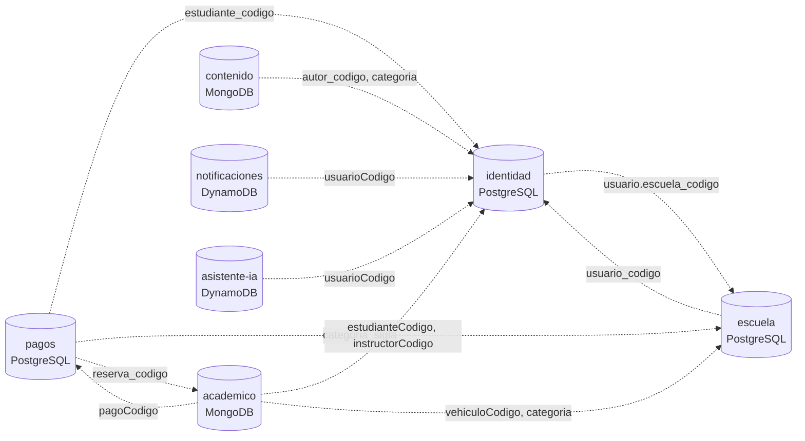
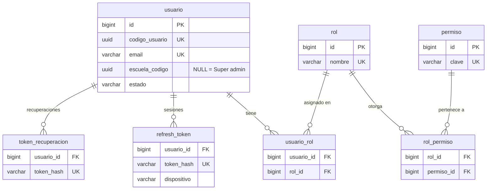
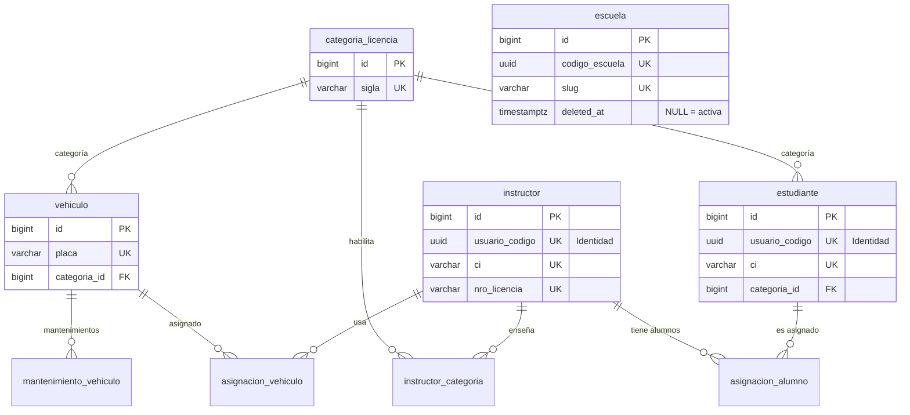
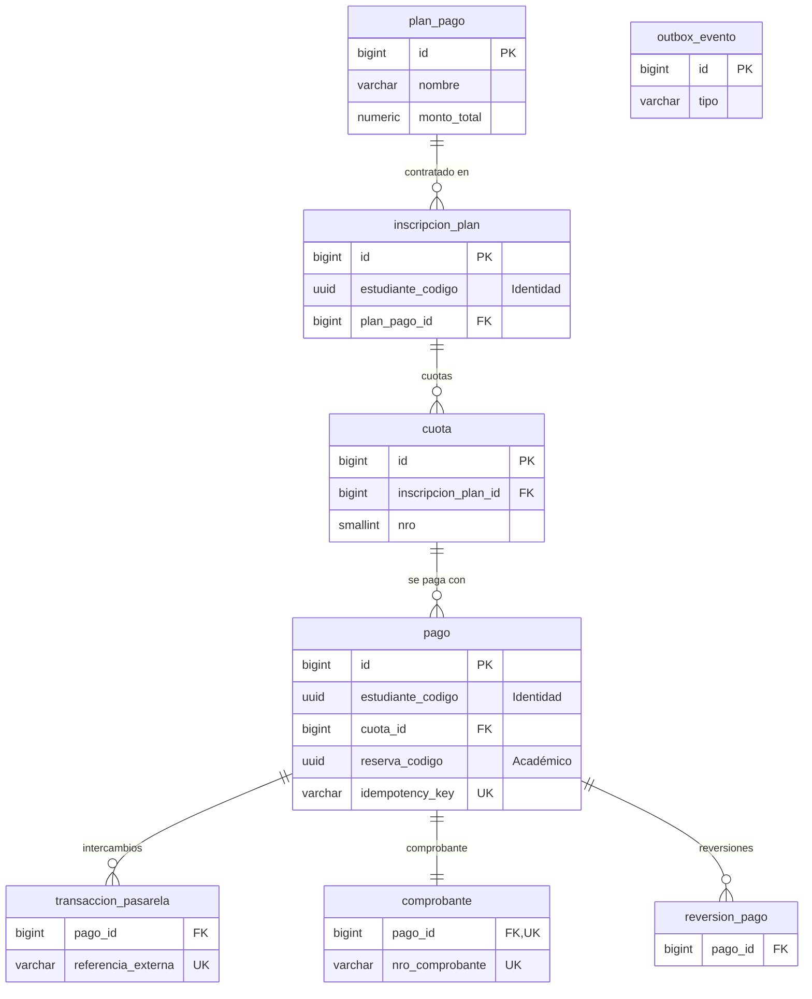
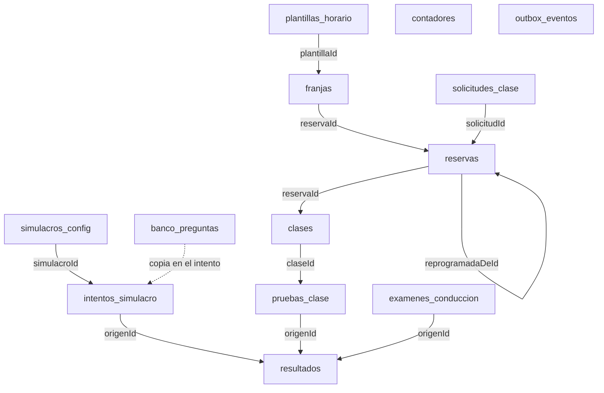

# Diseño de base de datos — estado real

> **Fuente de verdad.** Este documento describe las tablas, colecciones e
> ítems **tal como existen hoy en el código** (migraciones Flyway, documentos
> de Spring Data MongoDB, migraciones de Laravel y definiciones de DynamoDB).
> El PDF [`DriveHub_Diseno_Base_de_Datos.pdf`](DriveHub_Diseno_Base_de_Datos.pdf)
> queda como **guía histórica**: si algo difiere, gana este archivo.
>
> **Se actualiza en el mismo cambio que toca el esquema** (una migración
> nueva, un campo nuevo en un documento, un GSI nuevo), igual que
> [`docs/errors/`](../errors/README.md) con los códigos de error.
>
> Reglas de implementación (ids, nombres, migraciones, soft delete):
> [PERSISTENCIA_BD_BACKEND.md](../../.claude/rules/backend/PERSISTENCIA_BD_BACKEND.md).

Última revisión: 2026-10-19 (hasta CU02).

## Contenido

1. [Visión general](#1-visión-general)
2. [Identidad — PostgreSQL](#2-identidad--postgresql)
3. [Escuela — PostgreSQL](#3-escuela--postgresql)
4. [Pagos — PostgreSQL](#4-pagos--postgresql)
5. [Académico — MongoDB](#5-académico--mongodb)
6. [Contenido — MongoDB](#6-contenido--mongodb)
7. [Notificaciones — DynamoDB](#7-notificaciones--dynamodb)
8. [Asistente IA — DynamoDB](#8-asistente-ia--dynamodb)
9. [Referencias entre servicios](#9-referencias-entre-servicios)
10. [Diferencias con el PDF y pendientes](#10-diferencias-con-el-pdf-y-pendientes)

---

## 1. Visión general

| Servicio | Base | Nombre | Tablas / colecciones | Cómo se crea el esquema |
| --- | --- | --- | --- | --- |
| `identidad` | PostgreSQL 18 | `identidad` | 7 | Flyway (`V…__*.sql`) |
| `escuela` | PostgreSQL 18 | `escuela` | 9 | Flyway |
| `pagos` | PostgreSQL 18 | `pagos` | 8 | Flyway |
| `academico` | MongoDB 8 (replica set `rs0`) | `academico` | 13 | Spring Data (`@Document`, `@Indexed`) |
| `contenido` | MongoDB 8 (replica set `rs0`) | `contenido` | 2 + `contadores` | Migración de Laravel |
| `notificaciones` | DynamoDB | — | 4 | `definicion-tablas.ts` (se crean al arrancar en dev) |
| `asistente-ia` | DynamoDB | — | 4 | `tablas.py` (se crean al arrancar en dev) |

`gateway` no tiene base de datos. **Una base por servicio**: ninguno lee la base de otro.

### Convenciones comunes

- **PostgreSQL:** cada tabla lleva además `id BIGINT GENERATED ALWAYS AS IDENTITY PRIMARY KEY` (interno, no sale del servicio), `codigo_{tabla} UUID NOT NULL UNIQUE` (público, UUID v7 generado por la aplicación) y `created_at`, `updated_at`, `deleted_at` (`TIMESTAMPTZ`, soft delete). **No se repiten en las tablas de abajo**: solo se listan las columnas propias.
- **MongoDB:** cada documento lleva `_id` (Long secuencial, interno, de la colección `contadores`), `codigo{Coleccion}` / `codigo_{coleccion}` (UUID v7 público, índice único), `createdAt`/`updatedAt`/`deletedAt` (o `created_at`/… en Laravel). Tampoco se repiten. Los subdocumentos y arrays se guardan nativos.
- **DynamoDB:** no hay id Long; la clave primaria es el identificador. Los atributos van en `camelCase`.
- **Referencias a otro servicio:** `{entidad}_codigo` / `{entidad}Codigo` con el código público del dueño, **sin FK física** (ver [sección 9](#9-referencias-entre-servicios)).
- **Estados:** `VARCHAR` + `CHECK` en PostgreSQL; en Mongo/Dynamo, el valor del enum de código.

### Mapa de dependencias entre servicios

Las líneas punteadas son **referencias por código, sin FK**: se validan al escribir (REST al dueño) o se mantienen por eventos.

---

## 2. Identidad — PostgreSQL

Cuentas, roles, permisos y sesiones. Migraciones: `V20261018120000__crear_esquema_identidad.sql`, `V20261019110000__usuario_escuela_y_roles.sql` (CU01), `V20261019120000__usuario_bloqueado_hasta.sql` (CU02), `V20261020120000__correo_verificado_y_tipo_token.sql` (CU04b).

### `usuario`

Cuenta de acceso. `codigo_usuario` es la **persona única** en toda la plataforma. CU01, CU02, CU06.

| Columna | Tipo | Notas |
| --- | --- | --- |
| `email` | `VARCHAR(120) NOT NULL UNIQUE` | Login. Único en **toda** la plataforma, guardado en minúsculas |
| `password_hash` | `VARCHAR(255) NOT NULL` | BCrypt, nunca en claro |
| `nombres` | `VARCHAR(80) NOT NULL` | |
| `apellidos` | `VARCHAR(80) NOT NULL` | |
| `telefono` | `VARCHAR(20)` | |
| `foto_url` | `TEXT` | Clave del archivo en el bucket `drivehub-identidad` |
| `fecha_nacimiento` | `DATE NOT NULL` | Para validar la edad mínima (18) al registrarse. *CU01* |
| `escuela_codigo` | `UUID` | Escuela (tenant) de la cuenta, **sin FK** → `escuela.codigo_escuela`. `NULL` para el Super admin. Índice `idx_usuario_escuela_codigo`. *CU01* |
| `estado` | `VARCHAR(12) NOT NULL DEFAULT 'ACTIVO'` | `CHECK IN ('ACTIVO','INACTIVO','BLOQUEADO')` |
| `intentos_fallidos` | `INT NOT NULL DEFAULT 0` | Se reinicia en un login correcto. Bloqueo al 5.º fallo. *CU02* |
| `bloqueado_hasta` | `TIMESTAMPTZ` | Fin del bloqueo (15 min); se levanta solo. *CU02* |
| `correo_verificado` | `BOOLEAN NOT NULL DEFAULT FALSE` | El correo se verificó con el enlace enviado. Todas las cuentas, también las existentes, empiezan en `false`. No bloquea el login: solo condiciona la recuperación de contraseña. *CU04b* |
| `ultimo_login` | `TIMESTAMPTZ` | |

### `rol`

Catálogo de roles. Sembrado por migración (los nombres son **datos**, no un enum cerrado).

| Columna | Tipo | Notas |
| --- | --- | --- |
| `nombre` | `VARCHAR(30) NOT NULL UNIQUE` | `SUPER_ADMIN`, `ADMIN_ESCUELA`, `INSTRUCTOR`, `ESTUDIANTE` |
| `descripcion` | `VARCHAR(120)` | |

### `permiso`

Permisos finos (previstos, sin caso de uso asignado: el CU05 original, gestionar roles y permisos, se reasignó a Gestionar escuelas). Todavía sin filas.

| Columna | Tipo | Notas |
| --- | --- | --- |
| `clave` | `VARCHAR(60) NOT NULL UNIQUE` | Ej. `reserva.crear` |
| `descripcion` | `VARCHAR(120)` | |

### `usuario_rol`

Roles de cada usuario (asociación con código propio, no `@ManyToMany`).

| Columna | Tipo | Notas |
| --- | --- | --- |
| `usuario_id` | `BIGINT NOT NULL REFERENCES usuario(id)` | |
| `rol_id` | `BIGINT NOT NULL REFERENCES rol(id)` | Índice `idx_usuario_rol_rol_id` |
| `asignado_en` | `TIMESTAMPTZ NOT NULL DEFAULT now()` | |
| | `UNIQUE (usuario_id, rol_id)` | |

### `rol_permiso`

| Columna | Tipo | Notas |
| --- | --- | --- |
| `rol_id` | `BIGINT NOT NULL REFERENCES rol(id)` | |
| `permiso_id` | `BIGINT NOT NULL REFERENCES permiso(id)` | Índice `idx_rol_permiso_permiso_id` |
| | `UNIQUE (rol_id, permiso_id)` | |

### `refresh_token`

Sesiones renovables (CU02, CU03). **Solo el hash SHA-256**: el valor en claro lo tiene el cliente. Una sesión activa por usuario y dispositivo.

| Columna | Tipo | Notas |
| --- | --- | --- |
| `usuario_id` | `BIGINT NOT NULL REFERENCES usuario(id)` | |
| `token_hash` | `VARCHAR(64) NOT NULL UNIQUE` | SHA-256 en hexadecimal |
| `dispositivo` | `VARCHAR(10) NOT NULL` | `CHECK IN ('WEB','MOVIL')` |
| `expira_en` | `TIMESTAMPTZ NOT NULL` | 7 días desde cada renovación |
| `revocado` | `BOOLEAN NOT NULL DEFAULT FALSE` | `true` al renovar (rotación), al iniciar sesión de nuevo en el dispositivo y en CU03 |

Índice `idx_refresh_token_usuario_revocado (usuario_id, revocado)`.

### `token_recuperacion`

Enlaces enviados por correo, de un solo uso: verificar el correo (CU04b) y restablecer la contraseña (CU04). Solo se guarda el hash.

| Columna | Tipo | Notas |
| --- | --- | --- |
| `usuario_id` | `BIGINT NOT NULL REFERENCES usuario(id)` | Índice `idx_token_recuperacion_usuario_id` |
| `tipo` | `VARCHAR(20) NOT NULL DEFAULT 'RECUPERACION'` | `CHECK IN ('RECUPERACION','VERIFICACION')`. Un enlace de un tipo no sirve para el otro. *CU04b* |
| `token_hash` | `VARCHAR(64) NOT NULL UNIQUE` | |
| `expira_en` | `TIMESTAMPTZ NOT NULL` | |
| `usado` | `BOOLEAN NOT NULL DEFAULT FALSE` | |

**Datos sembrados:** los 4 roles (migración). En el perfil `dev`, además, `superadmin@gmail.com` (`SUPER_ADMIN`, sin escuela) y `adminexample@gmail.com` (`ADMIN_ESCUELA` de `escuelaexample`), ambos con contraseña `123123123`.

---

## 3. Escuela — PostgreSQL

Escuelas (tenants), personas de la escuela, flota y asignaciones. Migraciones: `V20261018120000__crear_esquema_escuela.sql`, `V20261019100000__crear_tabla_escuela.sql` (CU01), `V20261021100000__escuela_estado_por_borrado_logico.sql` (CU05).

> `escuela` aún **no** se relaciona con las demás tablas de este servicio: el `escuela_codigo` en `estudiante`, `instructor`, `vehiculo`... se agrega con el diseño del filtro por tenant (antes de CU07 y CU08). Ver [sección 10](#10-diferencias-con-el-pdf-y-pendientes).

### `escuela`

El **tenant** de la plataforma SaaS: cada autoescuela cliente es una fila. CU01, CU02, CU05.

| Columna | Tipo | Notas |
| --- | --- | --- |
| `codigo_escuela` | `UUID NOT NULL UNIQUE` | Es el `escuela_codigo` que guardan los demás servicios |
| `slug` | `VARCHAR(60) NOT NULL UNIQUE` | Identificador legible del enlace de registro (`/register/{slug}`) |
| `nombre` | `VARCHAR(120) NOT NULL` | |
| `deleted_at` | `TIMESTAMPTZ` | Borrado lógico y **única fuente del estado**: activa si es `NULL`, inactiva si tiene fecha. Una escuela inactiva no admite registros ni inicios de sesión de nadie de ella. Desactivar es poner la fecha y reactivar es quitarla (CU05) |

La columna `estado` (`ACTIVA`/`INACTIVA`) se **eliminó** en `V20261021100000`: era una segunda fuente que podía contradecir a `deleted_at`; la migración pasó a borrado lógico las filas que estaban `INACTIVA`. Como el filtro automático de soft delete oculta las filas eliminadas, el listado, la consulta por código y la unicidad del `slug` (que sigue reservado aunque la escuela esté eliminada) usan consultas nativas.

En `dev` se siembra `escuelaexample` con código fijo `0198f0a0-0000-7000-8000-000000000001`.

### `categoria_licencia`

Catálogo (A, B, C…). `sigla` es el valor que usan los demás servicios.

| Columna | Tipo | Notas |
| --- | --- | --- |
| `sigla` | `VARCHAR(3) NOT NULL UNIQUE` | |
| `descripcion` | `VARCHAR(100) NOT NULL` | |
| `edad_minima` | `SMALLINT` | |
| `clases_minimas` | `SMALLINT` | Mínimo de clases prácticas para rendir el examen |

### `estudiante`

Perfil del estudiante (CU08).

| Columna | Tipo | Notas |
| --- | --- | --- |
| `usuario_codigo` | `UUID NOT NULL UNIQUE` | → `identidad.usuario.codigo_usuario`, sin FK |
| `ci` | `VARCHAR(15) NOT NULL UNIQUE` | |
| `fecha_nacimiento` | `DATE` | |
| `direccion` | `VARCHAR(200)` | |
| `categoria_id` | `BIGINT REFERENCES categoria_licencia(id)` | Índice `idx_estudiante_categoria_id` |
| `estado` | `VARCHAR(12) NOT NULL DEFAULT 'ACTIVO'` | `CHECK IN ('ACTIVO','EGRESADO','RETIRADO')` |
| `fecha_inscripcion` | `DATE` | |
| `observaciones` | `TEXT` | |

### `instructor`

Perfil del instructor (CU09).

| Columna | Tipo | Notas |
| --- | --- | --- |
| `usuario_codigo` | `UUID NOT NULL UNIQUE` | → `identidad.usuario.codigo_usuario`, sin FK |
| `ci` | `VARCHAR(15) NOT NULL UNIQUE` | |
| `nro_licencia` | `VARCHAR(30) NOT NULL UNIQUE` | |
| `licencia_vence` | `DATE` | |
| `estado` | `VARCHAR(12) NOT NULL DEFAULT 'ACTIVO'` | `CHECK IN ('ACTIVO','INACTIVO','LICENCIA')` |
| `fecha_contratacion` | `DATE` | |

### `instructor_categoria`

Categorías que enseña cada instructor.

| Columna | Tipo | Notas |
| --- | --- | --- |
| `instructor_id` | `BIGINT NOT NULL REFERENCES instructor(id)` | |
| `categoria_id` | `BIGINT NOT NULL REFERENCES categoria_licencia(id)` | Índice `idx_instructor_categoria_categoria_id` |
| | `UNIQUE (instructor_id, categoria_id)` | |

### `vehiculo`

Flota (CU07).

| Columna | Tipo | Notas |
| --- | --- | --- |
| `placa` | `VARCHAR(10) NOT NULL UNIQUE` | |
| `marca` | `VARCHAR(40) NOT NULL` | |
| `modelo` | `VARCHAR(40) NOT NULL` | |
| `anio` | `SMALLINT` | |
| `color` | `VARCHAR(20)` | |
| `transmision` | `VARCHAR(10) NOT NULL` | `CHECK IN ('MANUAL','AUTOMATICO')` |
| `categoria_id` | `BIGINT REFERENCES categoria_licencia(id)` | Índice `idx_vehiculo_categoria_id` |
| `estado` | `VARCHAR(14) NOT NULL DEFAULT 'DISPONIBLE'` | `CHECK IN ('DISPONIBLE','MANTENIMIENTO','BAJA')` |
| `kilometraje` | `INT NOT NULL DEFAULT 0` | |
| `soat_vence` | `DATE` | |
| `inspeccion_vence` | `DATE` | |

### `mantenimiento_vehiculo`

| Columna | Tipo | Notas |
| --- | --- | --- |
| `vehiculo_id` | `BIGINT NOT NULL REFERENCES vehiculo(id)` | Índice `idx_mantenimiento_vehiculo_vehiculo_id` |
| `fecha` | `DATE NOT NULL` | |
| `tipo` | `VARCHAR(12) NOT NULL` | `CHECK IN ('PREVENTIVO','CORRECTIVO')` |
| `descripcion` | `TEXT` | |
| `costo` | `NUMERIC(10,2)` | |
| `km_al_momento` | `INT` | |

### `asignacion_vehiculo`

Qué instructor usa cada auto (CU10). Un vehículo tiene una sola asignación vigente.

| Columna | Tipo | Notas |
| --- | --- | --- |
| `vehiculo_id` | `BIGINT NOT NULL REFERENCES vehiculo(id)` | |
| `instructor_id` | `BIGINT NOT NULL REFERENCES instructor(id)` | Índice `idx_asignacion_vehiculo_instructor_id` |
| `fecha_inicio` | `DATE NOT NULL` | |
| `fecha_fin` | `DATE` | `NULL` = vigente |
| | `UNIQUE (vehiculo_id) WHERE fecha_fin IS NULL AND deleted_at IS NULL` | `uq_asignacion_vehiculo_vigente` |

### `asignacion_alumno`

Instructor asignado a cada estudiante. Un estudiante tiene un solo instructor vigente.

| Columna | Tipo | Notas |
| --- | --- | --- |
| `instructor_id` | `BIGINT NOT NULL REFERENCES instructor(id)` | Índice `idx_asignacion_alumno_instructor_id` |
| `estudiante_id` | `BIGINT NOT NULL REFERENCES estudiante(id)` | |
| `fecha_inicio` | `DATE NOT NULL` | |
| `fecha_fin` | `DATE` | `NULL` = vigente |
| | `UNIQUE (estudiante_id) WHERE fecha_fin IS NULL AND deleted_at IS NULL` | `uq_asignacion_alumno_vigente` |

---

## 4. Pagos — PostgreSQL

Planes, cuotas, pagos, pasarela, comprobantes y reversiones. Migración: `V20261018120000__crear_esquema_pagos.sql`. El estado de la saga reserva-pago **no** vive acá ([SAGA_RESERVA_PAGO.md](SAGA_RESERVA_PAGO.md)).

### `plan_pago` (CU25)

| Columna | Tipo | Notas |
| --- | --- | --- |
| `nombre` | `VARCHAR(80) NOT NULL` | |
| `categoria_sigla` | `VARCHAR(3)` | → `escuela.categoria_licencia.sigla`, sin FK |
| `nro_clases` | `SMALLINT NOT NULL` | |
| `monto_total` | `NUMERIC(10,2) NOT NULL` | |
| `nro_cuotas` | `SMALLINT NOT NULL` | |
| `activo` | `BOOLEAN NOT NULL DEFAULT TRUE` | |

### `inscripcion_plan` (CU25, CU28)

Plan contratado por un estudiante.

| Columna | Tipo | Notas |
| --- | --- | --- |
| `estudiante_codigo` | `UUID NOT NULL` | → Identidad. Índice `idx_inscripcion_plan_estudiante_codigo` |
| `plan_pago_id` | `BIGINT NOT NULL REFERENCES plan_pago(id)` | Índice `idx_inscripcion_plan_plan_pago_id` |
| `monto_total` | `NUMERIC(10,2) NOT NULL` | |
| `saldo` | `NUMERIC(10,2) NOT NULL` | |
| `estado` | `VARCHAR(12) NOT NULL DEFAULT 'ACTIVO'` | `CHECK IN ('ACTIVO','COMPLETADO','CANCELADO')` |
| `fecha_inicio` | `DATE NOT NULL` | |

### `cuota` (CU25, CU28)

| Columna | Tipo | Notas |
| --- | --- | --- |
| `inscripcion_plan_id` | `BIGINT NOT NULL REFERENCES inscripcion_plan(id)` | |
| `nro` | `SMALLINT NOT NULL` | `UNIQUE (inscripcion_plan_id, nro)` |
| `monto` | `NUMERIC(10,2) NOT NULL` | |
| `fecha_vence` | `DATE NOT NULL` | |
| `estado` | `VARCHAR(10) NOT NULL DEFAULT 'PENDIENTE'` | `CHECK IN ('PENDIENTE','PAGADA','VENCIDA','ANULADA')` |

Índice `idx_cuota_estado_fecha_vence (estado, fecha_vence)` para el job de vencidas.

### `pago` (CU26 a CU29)

`idempotency_key` evita cobros duplicados por reintentos.

| Columna | Tipo | Notas |
| --- | --- | --- |
| `estudiante_codigo` | `UUID NOT NULL` | → Identidad. Índice `idx_pago_estudiante_created (estudiante_codigo, created_at DESC)` |
| `concepto` | `VARCHAR(10) NOT NULL` | `CHECK IN ('CUOTA','CLASE','EXAMEN')` |
| `cuota_id` | `BIGINT REFERENCES cuota(id)` | Índice `idx_pago_cuota_id` |
| `reserva_codigo` | `UUID` | → `academico.reservas.codigoReserva`, sin FK. Índice `idx_pago_reserva_codigo` |
| `monto` | `NUMERIC(10,2) NOT NULL` | |
| `moneda` | `CHAR(3) NOT NULL DEFAULT 'BOB'` | |
| `metodo` | `VARCHAR(15) NOT NULL` | `CHECK IN ('QR','TRANSFERENCIA','EFECTIVO')` |
| `estado` | `VARCHAR(10) NOT NULL DEFAULT 'PENDIENTE'` | `CHECK IN ('PENDIENTE','CONFIRMADO','FALLIDO','REVERTIDO')` |
| `idempotency_key` | `VARCHAR(64) NOT NULL UNIQUE` | |
| `saga_codigo` | `UUID` | Saga reserva-pago (CU44) |
| `confirmado_en` | `TIMESTAMPTZ` | |

### `transaccion_pasarela` (CU26, CU27)

| Columna | Tipo | Notas |
| --- | --- | --- |
| `pago_id` | `BIGINT NOT NULL REFERENCES pago(id)` | Índice `idx_transaccion_pasarela_pago_id` |
| `proveedor` | `VARCHAR(30) NOT NULL` | |
| `referencia_externa` | `VARCHAR(80) UNIQUE` | |
| `qr_payload` | `TEXT` | |
| `estado` | `VARCHAR(12) NOT NULL` | |
| `respuesta` | `JSONB` | |

### `comprobante` (CU30)

Uno por pago.

| Columna | Tipo | Notas |
| --- | --- | --- |
| `pago_id` | `BIGINT NOT NULL UNIQUE REFERENCES pago(id)` | |
| `nro_comprobante` | `VARCHAR(20) NOT NULL UNIQUE` | |
| `monto` | `NUMERIC(10,2) NOT NULL` | |
| `emitido_en` | `TIMESTAMPTZ NOT NULL` | |
| `url_pdf` | `TEXT` | |

### `reversion_pago` (CU31)

Compensación de la saga.

| Columna | Tipo | Notas |
| --- | --- | --- |
| `pago_id` | `BIGINT NOT NULL REFERENCES pago(id)` | Índice `idx_reversion_pago_pago_id` |
| `motivo` | `VARCHAR(200)` | |
| `monto` | `NUMERIC(10,2)` | |
| `estado` | `VARCHAR(10) NOT NULL DEFAULT 'SOLICITADA'` | `CHECK IN ('SOLICITADA','EJECUTADA','FALLIDA')` |
| `saga_codigo` | `UUID` | |
| `ejecutado_en` | `TIMESTAMPTZ` | |

### `outbox_evento` (CU27, CU44)

Eventos pendientes de publicar a RabbitMQ: se escriben en la misma transacción que el cambio y un proceso aparte los publica.

| Columna | Tipo | Notas |
| --- | --- | --- |
| `tipo` | `VARCHAR(60) NOT NULL` | |
| `payload` | `JSONB NOT NULL` | |
| `publicado_en` | `TIMESTAMPTZ` | `NULL` hasta que RabbitMQ confirma. Índice parcial `idx_outbox_evento_pendientes (created_at) WHERE publicado_en IS NULL` |

---

## 5. Académico — MongoDB

Horarios, reservas, clases, exámenes y simulacros. Los índices se declaran en el código (`@Indexed`, `@CompoundIndex`; `auto-index-creation=true`). Las referencias a otras colecciones del mismo servicio usan el `_id` Long (`franjaId`, `reservaId`…); a otros servicios, el código público.

### `contadores`

Secuencias para el `_id` Long de cada colección (`{ _id: "reservas", secuencia: 42 }`), con `$inc` atómico.

### `plantillas_horario` (CU12)

Horario semanal base del instructor.

| Campo | Tipo | Notas |
| --- | --- | --- |
| `codigoPlantillaHorario` | UUID | Único |
| `instructorCodigo` | UUID | → Identidad. Índice |
| `vehiculoCodigo` | UUID | → Escuela `vehiculo.codigo_vehiculo` |
| `diaSemana` | int | 1 (lunes) a 7 (domingo) |
| `horaInicio`, `horaFin` | string | `HH:mm` |
| `duracionClaseMin` | int | Ej. 60 |
| `vigenteDesde` | date | |
| `vigenteHasta` | date | Opcional |
| `activa` | boolean | |

### `franjas` (CU11, CU12, CU14, CU16)

Horario concreto reservable. Reservar es un `findOneAndUpdate` de `LIBRE` a `RESERVADA` (atómico).

| Campo | Tipo | Notas |
| --- | --- | --- |
| `codigoFranja` | UUID | Único |
| `plantillaId` | long | Opcional → `plantillas_horario._id` |
| `instructorCodigo`, `vehiculoCodigo` | UUID | Identidad / Escuela |
| `fecha` | date | |
| `horaInicio`, `horaFin` | string | `HH:mm` |
| `estado` | enum | `LIBRE`, `RESERVADA`, `BLOQUEADA` |
| `reservaId` | long | Opcional → `reservas._id` |

Índices únicos: `uq_franja_instructor_fecha_hora (instructorCodigo, fecha, horaInicio)` y `uq_franja_vehiculo_fecha_hora (vehiculoCodigo, fecha, horaInicio)`.

### `solicitudes_clase` (CU13)

| Campo | Tipo | Notas |
| --- | --- | --- |
| `codigoSolicitudClase` | UUID | Único |
| `estudianteCodigo` | UUID | → Identidad. Índice |
| `categoria` | string | Sigla de categoría |
| `tipo` | enum | `PRACTICA`, `TEORICA` |
| `cantidadClases` | int | |
| `preferencias` | subdocumento | `{ dias: [1..7], turno: MANANA\|TARDE\|NOCHE }`. Opcional |
| `estado` | enum | `PENDIENTE`, `APROBADA`, `RECHAZADA`, `CANCELADA` |
| `motivoRechazo` | string | Opcional |
| `resueltaPorCodigo` | UUID | Opcional (admin/instructor) |
| `resueltaEn` | instant | |

### `reservas` (CU14, CU15, CU16)

| Campo | Tipo | Notas |
| --- | --- | --- |
| `codigoReserva` | UUID | Único |
| `estudianteCodigo`, `instructorCodigo`, `vehiculoCodigo` | UUID | Identidad / Escuela |
| `franjaId` | long | → `franjas._id` |
| `solicitudId` | long | Opcional → `solicitudes_clase._id` |
| `fecha`, `horaInicio`, `horaFin` | date, string, string | **Copia** de la franja, para consultar sin join |
| `estado` | enum | `PENDIENTE_PAGO`, `CONFIRMADA`, `CANCELADA`, `COMPLETADA`, `NO_ASISTIO` |
| `pagoCodigo` | UUID | Opcional → Pagos `pago.codigo_pago` |
| `sagaCodigo` | UUID | Saga reserva-pago (CU44) |
| `reprogramadaDeId` | long | Opcional → `reservas._id` de la original |
| `historialEstados` | array | `[{ estado, en, motivo }]` |
| `expiraPagoEn` | instant | Si no se paga a tiempo, la saga cancela y libera la franja |

Índices compuestos: `idx_reserva_estudiante_fecha`, `idx_reserva_instructor_fecha`, `idx_reserva_estado_expira (estado, expiraPagoEn)`.

### `clases` (CU17)

| Campo | Tipo | Notas |
| --- | --- | --- |
| `codigoClase` | UUID | Único |
| `reservaId` | long | → `reservas._id`. Único |
| `estudianteCodigo`, `instructorCodigo`, `vehiculoCodigo` | UUID | Índices en estudiante e instructor |
| `fecha` | date | |
| `inicioReal`, `finReal` | instant | Opcionales |
| `asistencia` | enum | `PRESENTE`, `TARDE`, `AUSENTE` |
| `tema`, `observaciones` | string | |
| `kmInicio`, `kmFin` | int | |
| `estado` | enum | `ABIERTA`, `CERRADA` |

### `pruebas_clase` (CU18)

Evaluación práctica durante la clase.

| Campo | Tipo | Notas |
| --- | --- | --- |
| `codigoPruebaClase` | UUID | Único |
| `claseId` | long | → `clases._id`. Índice |
| `estudianteCodigo`, `instructorCodigo` | UUID | |
| `tipo` | enum | `MANEJO`, `ESTACIONAMIENTO`, `CIUDAD` |
| `criterios` | array | `[{ codigo (clave legible), descripcion, puntaje, maximo }]` |
| `puntajeTotal` | double | |
| `resultado` | enum | `APROBADO`, `REPROBADO` |
| `observaciones` | string | Opcional |
| `fecha` | date | |

### `examenes_conduccion` (CU22)

| Campo | Tipo | Notas |
| --- | --- | --- |
| `codigoExamenConduccion` | UUID | Único |
| `estudianteCodigo` | UUID | Índice |
| `categoria` | string | Sigla |
| `fechaProgramada` | instant | |
| `evaluadorCodigo`, `vehiculoCodigo` | UUID | |
| `intento` | int | 1, 2, 3… |
| `estado` | enum | `PROGRAMADO`, `REALIZADO`, `CANCELADO`, `NO_ASISTIO` |
| `puntaje` | double | Opcional |
| `resultado` | enum | `APROBADO`, `REPROBADO`. Opcional |
| `observaciones` | string | Opcional |

### `banco_preguntas` (CU19)

| Campo | Tipo | Notas |
| --- | --- | --- |
| `codigoPregunta` | UUID | Único |
| `categoria`, `tema` | string | Índice compuesto `idx_pregunta_categoria_tema_activa (categoria, tema, activa)` |
| `tipo` | enum | `OPCION_UNICA`, `OPCION_MULTIPLE`, `VERDADERO_FALSO` |
| `enunciado` | string | |
| `imagenUrl` | string | Opcional |
| `opciones` | array | `[{ id (letra), texto, correcta }]` |
| `explicacion` | string | Se muestra al corregir |
| `dificultad` | int | 1 a 3 |
| `activa` | boolean | |
| `creadaPorCodigo` | UUID | Persona de Identidad |

### `simulacros_config` (CU20)

| Campo | Tipo | Notas |
| --- | --- | --- |
| `codigoSimulacro` | UUID | Único |
| `nombre`, `categoria` | string | |
| `duracionMin`, `nroPreguntas` | int | |
| `puntajeAprobacion` | double | |
| `reglas` | array | `[{ tema, cantidad }]`: cuántas preguntas de cada tema por intento |
| `activo` | boolean | |

### `intentos_simulacro` (CU21)

Las preguntas se **copian** dentro del intento: editar el banco no altera intentos pasados.

| Campo | Tipo | Notas |
| --- | --- | --- |
| `codigoIntentoSimulacro` | UUID | Único |
| `simulacroId` | long | → `simulacros_config._id` |
| `estudianteCodigo` | UUID | Índice compuesto `idx_intento_estudiante_iniciado (estudianteCodigo, iniciadoEn DESC)` |
| `estado` | enum | `EN_CURSO`, `FINALIZADO`, `EXPIRADO` |
| `iniciadoEn`, `finalizadoEn` | instant | `finalizadoEn` opcional |
| `preguntas` | array | `[{ preguntaId, enunciado, opciones, elegidas, correcta }]` |
| `aciertos` | int | |
| `puntaje` | double | |
| `aprobado` | boolean | |

### `resultados` (CU23)

Vista consolidada de notas: se escribe al cerrar cada evaluación y publica `examen.calificado`.

| Campo | Tipo | Notas |
| --- | --- | --- |
| `codigoResultado` | UUID | Único |
| `estudianteCodigo` | UUID | Índice compuesto `idx_resultado_estudiante_fecha (estudianteCodigo, fecha DESC)` |
| `origen` | enum | `SIMULACRO`, `PRUEBA_CLASE`, `EXAMEN_CONDUCCION` |
| `origenId` | long | `_id` del documento de origen |
| `titulo` | string | |
| `puntaje` | double | |
| `aprobado` | boolean | |
| `fecha` | instant | |

### `outbox_eventos` (CU44)

| Campo | Tipo | Notas |
| --- | --- | --- |
| `codigoOutboxEvento` | UUID | Único |
| `tipo` | string | Ej. `clase.reservada`, `examen.calificado` |
| `payload` | documento | |
| `publicadoEn` | instant | `null` hasta que RabbitMQ confirma. Índice `idx_outbox_pendientes (publicadoEn, createdAt)` |

---

## 6. Contenido — MongoDB

Solo **metadatos**: los PDF y videos viven en el bucket `drivehub-contenido` de MinIO. Los campos van en `snake_case` (Eloquent). Migración: `2026_10_18_120000_crear_colecciones_contenido.php`. `_id` Long con la colección `contadores`.

### `manuales` (CU32, CU34)

| Campo | Tipo | Notas |
| --- | --- | --- |
| `codigo_manual` | UUID | Índice único `uq_manuales_codigo` |
| `titulo` | string | |
| `descripcion` | string | Opcional |
| `categoria` | string | Sigla de categoría (Escuela) o `GENERAL` |
| `tema` | string | Opcional |
| `version` | int | Sube cada vez que se reemplaza el archivo |
| `archivo` | subdocumento | `{ url, mime, tamano_bytes, sha256 }` |
| `estado` | enum | `BORRADOR`, `PUBLICADO`, `ARCHIVADO` |
| `etiquetas` | array de string | |
| `publicado_por_codigo` | UUID | Persona de Identidad |

Índices: `idx_manuales_estado_categoria (estado, categoria)` y de texto `idx_manuales_texto (titulo, descripcion, etiquetas)`.

### `tutoriales` (CU33, CU35)

| Campo | Tipo | Notas |
| --- | --- | --- |
| `codigo_tutorial` | UUID | Índice único `uq_tutoriales_codigo` |
| `titulo` | string | |
| `descripcion` | string | Opcional |
| `autor_codigo` | UUID | Instructor (Identidad) |
| `categoria` | string | Sigla de categoría |
| `tipo` | enum | `VIDEO`, `PDF`, `ENLACE` |
| `recurso` | subdocumento | `{ url, duracion_seg }` |
| `audiencia` | array de enum | `ESTUDIANTE` y/o `INSTRUCTOR` |
| `estado` | enum | `BORRADOR`, `PUBLICADO`, `ARCHIVADO` |
| `etiquetas` | array de string | |

Índices: `idx_tutoriales_autor_estado (autor_codigo, estado)` y de texto `idx_tutoriales_texto`.

---

## 7. Notificaciones — DynamoDB

Todo se consulta por usuario y fecha: partición `usuarioCodigo` (la persona de Identidad) y orden `sk = '<fecha ISO>#<codigoNotificacion>'`. Facturación `PAY_PER_REQUEST`.

| Tabla | Clave de partición | Clave de orden | TTL | Índices |
| --- | --- | --- | --- | --- |
| `Notificaciones` | `usuarioCodigo` (S) | `sk` (S) | `ttl` — 180 días | GSI `NoLeidas`: `usuarioCodigo` + `noLeidaTs` (proyección `ALL`, **disperso**) |
| `PreferenciasNotificacion` | `usuarioCodigo` (S) | — | — | — |
| `DispositivosPush` | `usuarioCodigo` (S) | `codigoDispositivoPush` (S) | — | — |
| `EventosProcesados` | `eventoCodigo` (S) | — | `ttl` — 7 días | — |

### `Notificaciones` (CU36, CU38)

| Atributo | Tipo | Notas |
| --- | --- | --- |
| `usuarioCodigo`, `sk` | S | Clave |
| `codigoNotificacion` | S | UUID v7 |
| `tipo` | S (enum) | `RESERVA`, `PAGO`, `EXAMEN`, `RECORDATORIO` |
| `canal` | S (enum) | `EMAIL`, `PUSH`, `IN_APP` |
| `titulo`, `mensaje` | S | |
| `datos` | M | Contexto para abrir el detalle (ej. `{ reservaCodigo, fecha }`). Opcional |
| `estado` | S (enum) | `ENVIADA`, `FALLIDA` |
| `leida` | BOOL | |
| `noLeidaTs` | S | **Solo existe mientras no se lea**: por eso el GSI `NoLeidas` lista únicamente las no leídas |
| `creadaEn` | S | ISO |
| `ttl` | N | Epoch en segundos (180 días) |

### `PreferenciasNotificacion` (CU37)

Un ítem por usuario.

| Atributo | Tipo | Notas |
| --- | --- | --- |
| `usuarioCodigo` | S | Clave |
| `codigoPreferenciasNotificacion` | S | UUID v7 |
| `canales` | M | `{ email, push, inApp }` (BOOL) |
| `tipos` | M | `{ RESERVA, PAGO, EXAMEN, RECORDATORIO }` (BOOL) |
| `silencioDesde`, `silencioHasta` | S | `HH:mm`. Opcionales |
| `email` | S | |
| `actualizadoEn` | S | |

### `DispositivosPush` (CU36)

Tokens de la app móvil.

| Atributo | Tipo | Notas |
| --- | --- | --- |
| `usuarioCodigo`, `codigoDispositivoPush` | S | Clave |
| `tokenFcm` | S | |
| `plataforma` | S (enum) | `ANDROID`, `IOS` |
| `activo` | BOOL | |
| `ultimoUso` | S | |

### `EventosProcesados` (CU36)

Idempotencia de los consumidores de RabbitMQ: el broker puede entregar el mismo evento dos veces.

| Atributo | Tipo | Notas |
| --- | --- | --- |
| `eventoCodigo` | S | Clave |
| `procesadoEn` | S | |
| `ttl` | N | Epoch en segundos (7 días) |

---

## 8. Asistente IA — DynamoDB

Las imágenes y audios no se guardan en las tablas: va la **clave del archivo** en el bucket `drivehub-asistente-ia`. Facturación `PAY_PER_REQUEST`.

| Tabla | Clave de partición | Clave de orden | Notas |
| --- | --- | --- | --- |
| `SesionesIA` | `usuarioCodigo` (S) | `sk` (S) = `<fecha ISO>#<codigoSesionIa>` | |
| `MensajesIA` | `sesionCodigo` (S) | `seq` (N) | Aparte de `SesionesIA` para no pasar el límite de 400 KB por ítem |
| `AyudasTablero` | `usuarioCodigo` (S) | `sk` (S) = `<fecha ISO>#<codigoAyudaTablero>` | |
| `AgentesIA` | `codigoAgenteIa` (S) | — | |

### `SesionesIA` (CU39)

Pruebas de conducción asistidas y chats.

| Atributo | Tipo | Notas |
| --- | --- | --- |
| `usuarioCodigo`, `sk` | S | Clave |
| `codigoSesionIa` | S | UUID v7 |
| `tipo` | S (enum) | `PRUEBA_CONDUCCION`, `CHAT` |
| `categoria`, `escenario` | S | Opcionales |
| `estado` | S (enum) | `EN_CURSO`, `FINALIZADA` |
| `puntaje` | N | Opcional |
| `retroalimentacion` | S | Opcional |
| `modelo` | S | Modelo de IA usado |
| `duracionSeg` | N | Opcional |
| `creadaEn` | S | |

### `MensajesIA` (CU39)

| Atributo | Tipo | Notas |
| --- | --- | --- |
| `sesionCodigo`, `seq` | S, N | Clave. `sesionCodigo` = `codigoSesionIa` |
| `codigoMensajeIa` | S | UUID v7 |
| `rol` | S (enum) | `USER`, `ASSISTANT` |
| `contenido` | S | |
| `mediaKey` | S | Clave de un archivo en el bucket. Opcional |
| `ts` | S | |

### `AyudasTablero` (CU40, CU42)

Ayuda por foto del tablero.

| Atributo | Tipo | Notas |
| --- | --- | --- |
| `usuarioCodigo`, `sk` | S | Clave |
| `codigoAyudaTablero` | S | UUID v7 |
| `imagenKey` | S | Clave del archivo en el bucket |
| `indicadores` | L de M | `[{ codigo (clave legible), nombre, confianza, severidad }]`. Los valores de `severidad` se fijan con CU40 |
| `respuesta` | S | Explicación para el estudiante |
| `modelo` | S | |
| `latenciaMs` | N | |
| `util` | BOOL | Opinión del estudiante. Opcional |
| `creadaEn` | S | |

### `AgentesIA` (CU43)

Agentes y flujos de n8n que expone DriveHub (n8n guarda su propio estado interno).

| Atributo | Tipo | Notas |
| --- | --- | --- |
| `codigoAgenteIa` | S | Clave (UUID v7) |
| `nombre`, `descripcion` | S | |
| `workflowN8n` | S | Id del flujo en n8n |
| `webhookUrl` | S | |
| `parametros` | M | Opcional |
| `activo` | BOOL | |
| `actualizadoPorCodigo` | S | Administrador (Identidad) que lo modificó por última vez |

---

## 9. Referencias entre servicios

Todas por **código público**, sin FK física.

| Desde | Campo | Hacia | Dueño del dato |
| --- | --- | --- | --- |
| `identidad.usuario` | `escuela_codigo` | `escuela.escuela.codigo_escuela` | Escuela |
| `escuela.estudiante` / `instructor` | `usuario_codigo` | `identidad.usuario.codigo_usuario` | Identidad |
| `pagos.plan_pago` | `categoria_sigla` | `escuela.categoria_licencia.sigla` | Escuela |
| `pagos.inscripcion_plan` / `pago` | `estudiante_codigo` | `identidad.usuario.codigo_usuario` | Identidad |
| `pagos.pago` | `reserva_codigo` | `academico.reservas.codigoReserva` | Académico |
| `academico.reservas` | `pagoCodigo` | `pagos.pago.codigo_pago` | Pagos |
| `academico.*` | `estudianteCodigo`, `instructorCodigo`, `evaluadorCodigo`, `creadaPorCodigo`, `resueltaPorCodigo` | `identidad.usuario.codigo_usuario` | Identidad |
| `academico.*` | `vehiculoCodigo` | `escuela.vehiculo.codigo_vehiculo` | Escuela |
| `academico.*` | `categoria` | `escuela.categoria_licencia.sigla` | Escuela |
| `contenido.manuales` / `tutoriales` | `publicado_por_codigo`, `autor_codigo` | `identidad.usuario.codigo_usuario` | Identidad |
| `contenido.*` | `categoria` | `escuela.categoria_licencia.sigla` | Escuela |
| `notificaciones.*`, `asistente-ia.*` | `usuarioCodigo` | `identidad.usuario.codigo_usuario` | Identidad |

---

## 10. Diferencias con el PDF y pendientes

### Cambios respecto al PDF (ya implementados)

| Cambio | Dónde | Por qué |
| --- | --- | --- |
| Roles: `ADMIN` pasó a `ADMIN_ESCUELA` y se agregó `SUPER_ADMIN` | `identidad.rol` | Los 4 roles reales del SaaS |
| Tabla nueva `escuela` | `escuela` | La escuela es el tenant de la plataforma |
| `fecha_nacimiento`, `escuela_codigo` | `identidad.usuario` | Edad mínima del registro (CU01) y escuela de la cuenta |
| `bloqueado_hasta` | `identidad.usuario` | Bloqueo temporal de 15 minutos (CU02) |
| `correo_verificado`; `token_recuperacion.tipo` | `identidad.usuario`, `identidad.token_recuperacion` | Verificar el correo (CU04b) y distinguir esos enlaces de los de recuperación |
| `permiso.clave` y `categoria_licencia.sigla` | `identidad`, `escuela` | Evitar chocar con el `codigo` UUID público |
| `created_at`/`updated_at`/`deleted_at` en vez de `creado_en`/`actualizado_en` | todas las tablas | Se unificó con `BaseModel` |
| Código público UUID v7 (no ULID) en DynamoDB | `notificaciones`, `asistente-ia` | Igual de ordenable por tiempo |

### Pendiente de diseñar

- **Filtro por tenant.** Falta `escuela_codigo` en las tablas de Escuela (`estudiante`, `instructor`, `vehiculo`…), Pagos, Académico, Contenido, Notificaciones y Asistente IA, y el mecanismo de filtrado automático por el claim `escuela` del JWT. Se diseña antes de CU07 y CU08; el claim ya viaja en el token (CU02).
- **Estado de la saga reserva-pago:** dueño por decidir ([SAGA_RESERVA_PAGO.md](SAGA_RESERVA_PAGO.md)).
- **Valores de `severidad`** de los indicadores del tablero (se fijan con CU40).
- **Job de limpieza** de `refresh_token` vencidos.
